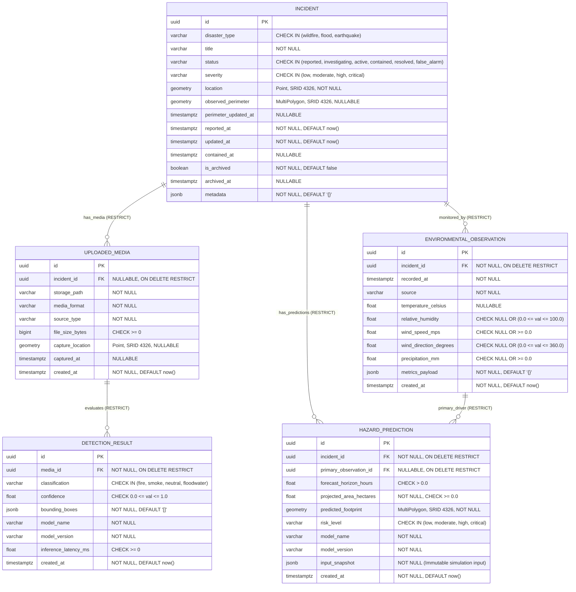

# SCOUT: Smart Crisis Observation & Understanding Technology

**Multimodal Disaster Intelligence & Response Platform**

SCOUT is an AI-powered disaster intelligence platform engineered to detect, monitor, forecast, and support response efforts for catastrophic natural events. Starting with wildfire observation and spread forecasting, SCOUT combines computer vision, geospatial intelligence, time-series forecasting, and multimodal generative AI within a scalable modular architecture.

---

## Architecture Overview

SCOUT follows a monorepo modular-monolith structure:

- `backend/`: FastAPI core service providing RESTful APIs, configuration, and data transport.
- `ml/`: Independent machine learning pipelines, geospatial raster analysis, and computer vision models (introduced in later blocks).
- `genai/`: Retrieval-Augmented Generation (RAG) and multi-agent crisis response systems (introduced in later blocks).
- `data/`: Segregated raw, processed, and external geospatial datasets.
- `docs/`: System documentation and Architecture Decision Records (ADRs).
- `infrastructure/`: Database migrations, Docker configs, and deployment scripts.

---

## Getting Started (Backend Foundation)

### Prerequisites

- Python 3.11+
- Git

### 1. Set Up Virtual Environment

From the project root:

```bash
# Create a local virtual environment
python -m venv .venv

# Activate the virtual environment
# Windows (PowerShell):
.venv\Scripts\Activate.ps1
# Linux / macOS:
source .venv/bin/activate
```

### 2. Install Foundation Dependencies

```bash
pip install -r backend/requirements.txt
```

### 3. Environment Configuration

Copy the example environment blueprint:

```bash
cp .env.example .env
```

### 4. Run Automated Tests

Execute the automated test suite from the `backend/` directory:

```bash
cd backend
pytest -v
```

### 5. Launch Local Development Server

Run the FastAPI application via Uvicorn:

```bash
cd backend
uvicorn app.main:app --reload --host 127.0.0.1 --port 8000
```

Once running:
- **Interactive OpenAPI Documentation (Swagger UI)**: [http://127.0.0.1:8000/docs](http://127.0.0.1:8000/docs)
- **Liveness Health Check**: [http://127.0.0.1:8000/api/v1/health](http://127.0.0.1:8000/api/v1/health)

---

## Database Infrastructure (PostgreSQL 16 + PostGIS 3.4)

SCOUT utilizes PostgreSQL 16 with the PostGIS 3.4 spatial extension as its core relational and geospatial engine, interfaced via synchronous SQLAlchemy 2.0 and Alembic.

### Database Environment Variables

The database connection is managed by Pydantic Settings in `backend/app/core/config.py` and configured in `.env`:

```env
POSTGRES_SERVER=127.0.0.1
POSTGRES_PORT=5432
POSTGRES_USER=scout_admin
POSTGRES_PASSWORD=scout_dev_password
POSTGRES_DB=scout
```

### Running the Database via Docker Compose

Once Docker Desktop is installed and running, manage the database container using Docker Compose:

```bash
# 1. Start the PostGIS container in the background
docker compose --env-file .env -f infrastructure/docker/docker-compose.yml up -d

# 2. Verify container status and health probe
docker compose --env-file .env -f infrastructure/docker/docker-compose.yml ps

# 3. Verify PostGIS extension is loaded inside PostgreSQL
docker exec scout-postgis psql -U scout_admin -d scout -c "SELECT PostGIS_Full_Version();"
```

### Stopping the Database

```bash
# Stop the database container preserving all persistent table data in scout_postgis_data volume
docker compose --env-file .env -f infrastructure/docker/docker-compose.yml down
```

> [!CAUTION]
> **Data Loss Warning:** Running `docker compose down -v` permanently deletes the persistent Docker volume (`scout_postgis_data`), destroying all stored incidents, media records, and predictions.

### Database Migrations (Alembic)

Alembic manages database schema evolution. All commands should be executed from the project root referencing `backend/alembic.ini`:

```bash
# Check current migration revision
python -m alembic -c backend/alembic.ini current

# View migration history
python -m alembic -c backend/alembic.ini history

# Generate a new autodetected migration (after models are declared)
python -m alembic -c backend/alembic.ini revision --autogenerate -m "describe migration"

# Apply migrations to database
python -m alembic -c backend/alembic.ini upgrade head
```

### Running Tests

Execute the complete test suite:

```bash
# Run all tests using backend/pytest.ini configuration
python -m pytest -c backend/pytest.ini -v

# Note on Database Integration Tests:
# Tests marked with @pytest.mark.database (e.g., test_db_connection.py) test real
# database connections. If Docker or PostgreSQL is not running, these tests skip
# cleanly without failing the build.
```

---

## Relational & Geospatial Schema (Milestone 03)

SCOUT implements five core database entities designed for multimodal disaster observation and forecasting:



### Core Architecture Principles:

1. **Anti-Cascade Deletion Policy (`ON DELETE RESTRICT`):**  
   All foreign keys strictly enforce `ON DELETE RESTRICT`. Incidents and evidence cannot be silently deleted via cascade. Historical records, sensor readings, and predictions remain preserved for forensic review.
2. **Archival Consistency Rule:**  
   Soft deletion is managed via `is_archived` and `archived_at`. A database CHECK constraint guarantees that non-archived incidents have `archived_at IS NULL`, while archived incidents have `archived_at IS NOT NULL`.
3. **Geospatial Rigor (SRID 4326):**  
   All coordinates and polygons are stored as WGS 84 `GEOMETRY(..., 4326)`. To avoid flat-earth distortion errors, distance searches (`ST_DWithin`) and area metrics cast geometries to PostGIS `GEOGRAPHY` for true spheroidal calculations on the WGS 84 ellipsoid. Functional GiST indexes are defined on `(location::geography)` and `(predicted_footprint::geography)`.
4. **Projected Area Calculation Responsibility:**  
   `projected_area_hectares` is persisted as a column with a `CHECK (projected_area_hectares >= 0.0)` constraint. To eliminate discrepancy between frontend map rendering and KPI summary cards, the future prediction persistence service calculates the area directly from the final stored geometry within the same transaction:
   $$\text{projected\_area\_hectares} = \frac{\text{ST\_Area}(\text{predicted\_footprint}::\text{geography})}{10{,}000.0}$$
5. **Prediction Immutability (Append-Only Policy):**  
   Predictions are append-only scientific artifacts. Updates and deletions are disallowed in application workflows. New scenarios or adjusted telemetry generate new prediction records, with initial conditions preserved immutably inside `input_snapshot`.
6. **Live Migration Status Note:**  
   Alembic migration `0001_initial_schema` is applied to the live PostgreSQL 16 / PostGIS 3.4 database running in Docker on `127.0.0.1:5432`.

---

## Incident Management API (Milestone 05)

The Incident Management API provides RESTful endpoints under `/api/v1/incidents` to record, list, inspect, update, and soft-archive disaster events.

### Endpoints

| Method | Path | Summary | Description |
| :--- | :--- | :--- | :--- |
| `POST` | `/api/v1/incidents` | Create Incident | Registers an incident. Coordinates stored as PostGIS Point (SRID 4326). |
| `GET` | `/api/v1/incidents` | List Incidents | Paginated, filtered, and sorted query. Excludes perimeter polygons. |
| `GET` | `/api/v1/incidents/{id}` | Get Incident Detail | Full details with projected coordinates, GeoJSON perimeter, and counts. |
| `PATCH`| `/api/v1/incidents/{id}` | Update Incident | Partial update for title, status, severity, location, or metadata. |
| `POST` | `/api/v1/incidents/{id}/archive` | Archive Incident | Soft-deletes an incident (sets `is_archived=True`). Idempotent. |

### Example Create Request
```http
POST /api/v1/incidents HTTP/1.1
Content-Type: application/json

{
  "title": "Blackwood Fire Incident",
  "disaster_type": "wildfire",
  "severity": "high",
  "location": {
    "latitude": 39.1234,
    "longitude": -120.4567
  },
  "metadata": {
    "reporting_agency": "USFS",
    "region": "Tahoe Basin"
  }
}
```

### Example List Response
```json
{
  "items": [
    {
      "id": "7b3b4f62-38d7-4632-a25e-3841a06584f2",
      "disaster_type": "wildfire",
      "title": "Blackwood Fire Incident",
      "status": "reported",
      "severity": "high",
      "location": {
        "latitude": 39.1234,
        "longitude": -120.4567,
        "srid": 4326
      },
      "observed_perimeter": null,
      "perimeter_updated_at": null,
      "reported_at": "2026-10-30T12:00:00Z",
      "updated_at": "2026-10-30T12:00:00Z",
      "contained_at": null,
      "is_archived": false,
      "archived_at": null,
      "metadata": {
        "reporting_agency": "USFS"
      }
    }
  ],
  "total": 1,
  "limit": 20,
  "offset": 0,
  "has_next": false,
  "has_prev": false
}
```

### Example Detail Response
```json
{
  "id": "7b3b4f62-38d7-4632-a25e-3841a06584f2",
  "disaster_type": "wildfire",
  "title": "Blackwood Fire Incident",
  "status": "active",
  "severity": "high",
  "location": {
    "latitude": 39.1234,
    "longitude": -120.4567,
    "srid": 4326
  },
  "observed_perimeter": null,
  "perimeter_updated_at": null,
  "reported_at": "2026-10-30T12:00:00Z",
  "updated_at": "2026-10-30T12:15:00Z",
  "contained_at": null,
  "is_archived": false,
  "archived_at": null,
  "metadata": {
    "reporting_agency": "USFS"
  },
  "summary_counts": {
    "media_count": 0,
    "observations_count": 0,
    "predictions_count": 0
  }
}
```

### Operational Status Transitions & Containment Lifecycle
The service enforces a strict lifecycle state machine:
- `reported` $\rightarrow$ `investigating`, `active`, `false_alarm`
- `investigating` $\rightarrow$ `active`, `contained`, `resolved`, `false_alarm`
- `active` $\rightarrow$ `contained`, `resolved`
- `contained` $\rightarrow$ `active`, `resolved`
- `resolved` $\rightarrow$ `active`
- `false_alarm` $\rightarrow$ Terminal state (no further transitions)

**Containment Timestamp (`contained_at`):**
- Transition to `contained`: sets `contained_at = now(utc)`.
- `contained` $\rightarrow$ `resolved`: preserves `contained_at`.
- `contained` $\rightarrow$ `active`: resets `contained_at = null` (containment breached).
- `resolved` $\rightarrow$ `active`: resets `contained_at = null`.
- Direct `active` $\rightarrow$ `resolved`: leaves `contained_at = null`.

### Pagination, Filtering, and Sorting
- **Filters:** `disaster_type`, `status`, `severity`, `is_archived` (default: `false`).
- **Pagination:** `limit` (1–100, default 20) and `offset` (default 0).
- **Sorting:** `order_by` (`reported_at`, `updated_at`, `severity`) and `order_direction` (`asc`, `desc`).
- **Operational Severity Order:** `critical` (1) > `high` (2) > `moderate` (3) > `low` (4).
- **Deterministic Pagination:** Every query applies `Incident.id.asc()` as a secondary sort key.

### Running the Test Suite
```bash
# Run all unit and integration tests (including live database tests)
python -m pytest -c backend/pytest.ini -v

# Run schema validation tests only
python -m pytest backend/tests/unit/test_incident_schemas.py -v

# Run live database incident integration tests
python -m pytest backend/tests/integration/test_incidents_api.py -v

# Run media ingestion tests
python -m pytest backend/tests/integration/test_media_api.py -v
```

---

## Milestone 06 — Media Ingestion Pipeline

Milestone 06 integrates a secure, reliable, and transaction-isolated media ingestion pipeline for drone feeds, satellite imagery, and field sensor photographs into the SCOUT platform.

### Architecture Overview

```
                      +------------------------------------+
                      |       Client Multipart Upload      |
                      +-----------------+------------------+
                                        | (Stream in 64KB chunks)
                                        v
                      +-----------------+------------------+
                      |   Magic Byte Signature Detector    |
                      |   (JPEG, PNG, WebP validation)     |
                      +-----------------+------------------+
                                        |
                 +----------------------+----------------------+
                 | (Exceeds 10MB or Corrupted)                 | (Valid & within limit)
                 v                                             v
     [Abort & Delete Temp File]                    [Stage in storage/tmp/]
     [HTTP 413 or HTTP 415]                                    |
                                                               v
                                                   [Atomic Promotion]
                                                   [storage/media/YYYY/MM/UUID.ext]
                                                               |
                                                               v
                                                   +-----------+------------+
                                                   | PostgreSQL / PostGIS   |
                                                   | (INSERT uploaded_media)|
                                                   +-----------+------------+
                                                               |
                                            +------------------+------------------+
                                            | (Commit Succeeded)                  | (Commit Failed)
                                            v                                     v
                                    [HTTP 201 Created]                [Rollback Transaction]
                                                                      [Delete Finalized File]
                                                                      (Zero Orphaned Files)
```

### Supported Media Formats & Validation

Client-supplied file extensions and MIME headers are strictly treated as untrusted. Files undergo a two-phase validation pipeline:
1. **Header Magic Byte Sniffer:** Fast preliminary byte signature check before streaming large payloads (JPEG: `0xFF 0xD8 0xFF`, PNG: `0x89 0x50 0x4E 0x47 0x0D 0x0A 0x1A 0x0A`, WebP: `RIFF....WEBP`).
2. **Pillow Deep Structural & Dimension Verification:** Reads chunks, markers, and checksums (`img.verify()`) without decompressing full bitmaps into memory. Rejects truncated images (`LOAD_TRUNCATED_IMAGES = False`), corrupted frames, decompression bombs (`MAX_IMAGE_PIXELS = 100,000,000`), and dimensions exceeding `16,384px`.

Unsupported formats, corrupted byte streams, executable payloads, and empty files are rejected with `HTTP 415` or `HTTP 400`.

### Source Type Policy
- Canonical categories defined in `MediaSourceType`: `drone`, `satellite`, `field_camera`, `ground_team`, `citizen_report`, `sensor`, `other`.
- Explicitly extensible: accepts custom acquisition platforms up to 32 characters (e.g. `flir_thermal_pod`).
- Rejects empty or whitespace-only values (`HTTP 400 INVALID_SOURCE_TYPE`).
- Rejects values exceeding 32 characters without silent truncation (`HTTP 400 INVALID_SOURCE_TYPE`).
- Defaults omitted values to `"other"`.

### Upload Size Limits & Streaming Storage

- **Max File Size:** Configurable via `MAX_UPLOAD_SIZE_BYTES` (default: `10485760` bytes / 10 MB).
- **Chunked Reading:** Files stream in 64 KB chunks directly to a temporary staging file (`storage/tmp/upload_<uuid>.tmp`) created exclusively (`open(..., "xb")`). Files are never buffered entirely in RAM.
- **Path Traversal Protection:** Relative storage paths are strictly resolved against `STORAGE_DIR/media`. Parent directory traversals (`..`) and absolute path injections are rejected.
- **Canonical Storage Layout:** Files are promoted atomically without overwrite to `storage/media/YYYY/MM/<uuid>.<ext>`.
- **Pre-commit Response Construction:** `MediaResponse` schema is constructed and validated prior to `db.commit()`, ensuring serialization failures cannot orphan committed database records.
- **Transactional Reconciliation:** If `db.commit()` raises an exception, the system reconciles state via a fresh database session:
  - If the record persisted, the file is preserved.
  - If confirmed absent, the promoted file is deleted immediately.
  - If database reachability is lost (uncertain state), the file is preserved to protect critical disaster intelligence evidence, and a critical reconciliation log is emitted.

### API Endpoints

| Method | Endpoint | Status | Description |
|---|---|---|---|
| `POST` | `/api/v1/media` | `201 Created` | Ingest raster image via `multipart/form-data` |
| `GET` | `/api/v1/media/{media_id}` | `200 OK` | Retrieve media metadata (no binary) |
| `GET` | `/api/v1/media` | `200 OK` | List & filter media metadata (paginated) |

#### Example: Multipart Upload via PowerShell
```powershell
$filePath = "sample_drone.jpg"
$form = @{
    file = Get-Item -Path $filePath
    incident_id = "06ea979d-82cf-473e-a151-6b8fd515a097"
    source_type = "drone"
    latitude = 37.7749
    longitude = -122.4194
    captured_at = "2026-10-30T10:00:00Z"
}
Invoke-RestMethod -Uri "http://127.0.0.1:8000/api/v1/media" -Method Post -Form $form
```

#### Example: Multipart Upload via curl
```bash
curl -X POST "http://127.0.0.1:8000/api/v1/media" \
  -F "file=@sample_drone.jpg;type=image/jpeg" \
  -F "incident_id=06ea979d-82cf-473e-a151-6b8fd515a097" \
  -F "source_type=drone" \
  -F "latitude=37.7749" \
  -F "longitude=-122.4194" \
  -F "captured_at=2026-10-30T10:00:00Z"
```

#### Example Response (`201 Created`):
```json
{
  "id": "e2c34d28-86f3-421b-80a5-f8bbcb7d9342",
  "incident_id": "06ea979d-82cf-473e-a151-6b8fd515a097",
  "storage_path": "2026/10/e2c34d28-86f3-421b-80a5-f8bbcb7d9342.jpg",
  "media_format": "jpeg",
  "source_type": "drone",
  "file_size_bytes": 1048576,
  "capture_location": {
    "latitude": 37.7749,
    "longitude": -122.4194,
    "srid": 4326
  },
  "captured_at": "2026-10-30T10:00:00Z",
  "created_at": "2026-10-30T14:30:00.000000Z"
}
```

### Security and Storage Safeguards
- **No Physical Path Exposure:** Internal server paths (e.g., `C:\Users\...`) are never leaked; only the canonical relative storage path is returned.
- **No Cascading Incident Deletion:** `uploaded_media.incident_id` maintains `ondelete="RESTRICT"`, preventing accidental loss of disaster intelligence evidence.
- **Git Exclusion:** `storage/` is registered in `.gitignore` to prevent media payloads from entering version control.


---

## Milestone 09: Environmental Data Integration

The Environmental Data Integration subsystem provides automated retrieval, validation, normalization, caching, querying, and scientific processing of meteorological data for disaster intelligence.

### Key Capabilities
- **Multi-Provider Architecture:** Pluggable adapters for Open-Meteo (current nowcasts, historical ERA5 reanalysis, NWP forecasts) and NASA POWER (MERRA-2 atmospheric assimilation).
- **Strict Provenance Typology:** Atmospheric observations strictly classified into `station_observed`, `reanalysis`, `model_analysis`, `forecast`, and `derived`.
- **SI/WMO Standardization:** Automatic unit conversion (°C, %, m/s, degrees, mm, hPa) and time standardization to UTC.
- **Resilient Layered Caching:** In-memory compound key caching with configurable TTLs (30m current, 2h forecast, 24h historical) and automatic stale-on-error fallback.
- **Canadian Fire Weather Index (FWI):** Complete Van Wagner (1985/1987) implementation computing FFMC, DMC, DC, ISI, BUI, FWI, and DSR with solar noon validation and benchmark verification.
- **Geospatial Exposure Integration:** Correlation of atmospheric wind vectors with M08 downstream vulnerable assets and infrastructure.

### API Endpoints (`/api/v1/environmental`)
| Method | Endpoint | Description |
|---|---|---|
| `GET` | `/health` | Subsystem and external provider health check |
| `GET` | `/current` | Current atmospheric conditions (strictly `model_analysis`) |
| `GET` | `/forecast` | Numerical weather prediction forecast time series |
| `GET` | `/historical` | Historical atmospheric reanalysis (ERA5 or MERRA-2) |
| `POST` | `/ingest` | On-demand retrieval, normalization, and DB upsert |
| `GET` | `/observations` | Query stored atmospheric observations with filtering |
| `POST` | `/fwi/calculate` | Canadian Forest Fire Weather Index calculation |

### Scientific Validation & Licensing Notes
- **FWI Scientific Standard & Benchmark:** Van Wagner (1985/1987) equations verified against independent published ground truth from Natural Resources Canada / Canadian Forest Service Information Report NOR-X-424 (Table 7, Wang et al. 2015) with unrounded error $\le 0.05$ across all 7 indices. Tropical daylength factors ($L_e = 9.0, L_f = 1.39$) implement the official CFS international standard (de Groot et al. 2007).
- **Timeseries Sequence Integrity:** `FWIEngine.calculate_series` enforces consecutive calendar days and rejects out-of-order, duplicate, or missing dates with `FWITimeseriesGapError`.
- **Regional Calibration Required:** Standard FWI danger class thresholds (Low to Extreme) are Canadian boreal pine standards; operational deployment in Indian ecosystems requires regional calibration against Forest Survey of India fire history.
- **Provider Licensing & Attribution:**
  - *Open-Meteo:* Meteorological data provided under Creative Commons Attribution 4.0 International (CC BY 4.0). Free tier is restricted to non-commercial evaluation; operational commercial use requires a paid commercial plan or self-hosted deployment.
  - *NASA POWER:* Gridded reanalysis provided by NASA Langley Research Center POWER Project / GMAO MERRA-2 Assimilation (US Public Domain). Mandates UTC time standard.
- **Geospatial & PostGIS Staging:** The runtime context catalog (`default_context_catalog`) starts empty in-memory and requires explicit layer loading or Milestone 10 database persistence. Schema migrations were verified offline via Alembic SQL generation and SQLite unit tests; live PostGIS execution requires a containerized PostgreSQL environment.

---

## Milestone 10: Persistent Geospatial Data Integration & Real-World Geographic Context

The Persistent Geospatial Data Integration subsystem establishes PostgreSQL/PostGIS as the persistent source of truth for real-world geographic features, replacing the temporary in-memory catalog limitation from Milestone 08.

### Key Capabilities
- **Persistent PostGIS Storage:** Production-grade SQLAlchemy models (`GeographicDataSource`, `GeographicIngestionRun`, `GeographicFeature`) storing WGS84 geometries with spatial GiST indexing and compound B-tree indexing on `(layer_name, category)`.
- **Complete Provenance & Licensing Compliance:** Registers external providers (OpenStreetMap, GHSL, ESA WorldCover, Copernicus DEM, Bhuvan, Survey of India) and enforces upstream attribution and licensing terms (ODbL 1.0, CC BY 4.0, Open Government Data).
- **Audit-Tracked Ingestion Pipeline:** Bounded batch GeoJSON parser with SHA-256 file integrity checksums, dry-run simulation mode, and deterministic deduplication via `(source_id, source_feature_id, layer_name)` supporting upsert, skip, and fail-on-conflict policies.
- **Administrative CLI:** Command-line tool `python -m app.geospatial.ingestion.cli` for loading regional layers and AOI datasets into PostGIS.
- **Bounded Spatial Queries:** Efficient bounding box envelope queries (`ST_MakeEnvelope`, `ST_Intersects`) and ellipsoidal geodesic radius queries (`ST_DWithin`, `ST_Distance`) with strict pagination guards preventing memory exhaustion.
- **Multi-Hazard Relevance Mapping:** Automatic topological classification and exposure tagging across wildfires, floods, and earthquakes.
- **Explicit Database Fallback & Provenance Semantics:** `GeospatialService` rigorously separates persistent PostGIS execution from in-memory catalog mode. If a database session is provided and returns 0 features, it never falls back to the local catalog (which would mask missing real-world data). If database queries fail, structured `PostGISUnavailableError` exceptions are raised immediately. Fallback to `local_vector_catalog` occurs only when explicitly unconfigured (`db=None`).
- **Calibration Area of Interest (AOI) & Synthetic Fixtures:** Pre-calibrated for the Dehradun Basin (`in_dehradun_basin`, bounding box `[77.9000, 30.1500, 78.2000, 30.4500]`). Note that `data/geospatial/calibration_dehradun_features.geojson` is an engineering calibration test fixture with idealized geometry and synthetic IDs; authentic regional OSM/Geofabrik datasets must be loaded for operational response.
- **Verification Status:** 417 unique automated tests verified (280 backend tests + 137 ML tests). Direct controller function testing avoids Starlette `TestClient` Windows Python 3.14 deadlocks. Live PostGIS database execution against a running PostgreSQL daemon is documented as `NOT VERIFIED (infrastructure dependent)`.

### API Endpoints (`/api/v1/geospatial`)
| Method | Endpoint | Description |
|---|---|---|
| `GET` | `/health` | Geospatial intelligence engine status and PostGIS connectivity probe |
| `POST` | `/validate-coordinate` | Earth coordinate boundary validation and UTM projection zone resolution |
| `GET` | `/nearby` | Query nearby spatial features within geodesic radius (PostGIS with catalog fallback) |
| `POST` | `/analyze` | Comprehensive multi-hazard geographic exposure and risk evaluation |
| `GET` | `/incidents/{id}/exposure` | Geographic exposure assessment for a registered incident UUID |
| `GET` | `/layers` | List registered geographic layers with feature counts and distinct categories |
| `GET` | `/features` | Spatially bounded feature search by bbox or radius with pagination and layer filtering |
| `GET` | `/sources` | List external data sources with provenance, licensing, and attribution metadata |
| `GET` | `/ingestion-runs` | Audit history of batch ingestion runs with checksums and feature statistics |

### Batch Ingestion CLI Usage
```bash
# Dry-run validation of a regional GeoJSON dataset
python -m app.geospatial.ingestion.cli \
  --file data/geospatial/calibration_dehradun_features.geojson \
  --layer critical_facilities \
  --provider openstreetmap \
  --dataset osm_critical_facilities \
  --aoi in_dehradun_basin \
  --dry-run

# Live ingestion with upsert deduplication
python -m app.geospatial.ingestion.cli \
  --file data/geospatial/calibration_dehradun_features.geojson \
  --layer critical_facilities \
  --provider openstreetmap \
  --dataset osm_critical_facilities \
  --aoi in_dehradun_basin \
  --conflict-policy upsert
```


---

## Milestone 13.1: Complete Frontend Application & Brand Integration

The SCOUT Frontend Application (`frontend/`) delivers an interactive, operational command center for disaster monitoring, geospatial exposure analysis, environmental danger indexing, and multi-agent emergency response workflows.

Built on React 18, TypeScript, Vite, Tailwind CSS, MapLibre GL JS, and TanStack Query, the interface translates complex multimodal intelligence into actionable, evidence-grounded insights for incident commanders.

### Key Capabilities & Pages

1. **Overview Dashboard (`/`):** Unified common operating picture (COP) displaying active incident metrics, pending human approval gate alerts, live MapLibre map, regional Canadian FWI danger ratings, and recent multi-agent workflow runs.
2. **Live Monitoring (`/monitoring`):** Expansive GIS canvas supporting real-time coordinate inspection, target jumping (WGS 84 / UTM), and multi-layer toggles (active hazards, hospitals, fire stations, rivers/hydrology, evacuation routes).
3. **Incident Intelligence (`/incidents`):** Deep investigation console fusing M07 computer vision classifications (with explicit uncalibrated score caveats), M09 weather telemetry, M10 geospatial proximity, and M11 multimodal epistemic reasoning.
4. **Geospatial Intelligence (`/geospatial`):** Dedicated GIS workbench featuring real-time coordinate boundary validation (EPSG:4326 to UTM zone resolution), geodesic radius filtering, and persistent PostGIS feature adjacency tables.
5. **Risk Assessment (`/risk`):** 5-dimensional risk synthesis breakdown (Hazard Status, Severity, Fire Weather, Exposure, Consequences), heuristic risk index gauge [0.0 - 100.0], key risk drivers, and spread-dampening mitigating factors.
6. **Response Workflows (`/workflows`):** M12 multi-agent workflow manager tracking the 7-stage LangGraph execution pipeline and providing an authenticated Human Review Gate with mandatory written justifications for plan rejection or revision.
7. **Reports & Dossiers (`/reports`):** Printable incident intelligence dossiers and text export options featuring executive summaries synthesized by Agent 6 (Coordinator Agent), action recommendations, and audit trails.
8. **Data Sources (`/data-sources`):** Complete transparency matrix detailing sensors, spatial resolution, update latency, and operational limitations for NASA FIRMS, Open-Meteo, NASA POWER, PostGIS, and M07 ML models.
9. **System Settings (`/settings`):** Reviewer security identity configuration, GIS coordinate defaults, telemetry polling rate adjustments, and official SCOUT brand palette swatches.

### Brand Identity & Safety Directives

- **Official Brand Asset:** Integrates `frontend/public/brand/scout-logo.png` across navigation, application headers, overview cards, and exported reports.
- **Color Palette:** Dark slate command palette (`#061321` background, `#0B1B2C` sidebar, `#28BCEB` cyan accent, `#FF781F` alert orange).
- **Safety Mandate:** Operates strictly as a decision-support advisory system. Autonomous dispatch is prohibited; all actionable response recommendations require explicit human commander approval.

### Frontend Development & Build Instructions

```bash
# 1. Navigate to the frontend directory
cd frontend

# 2. Install dependencies (Node.js 18+ required)
npm install

# 3. Launch Vite development server
npm run dev
```

- **Local Development URL:** [http://localhost:3000](http://localhost:3000)
- **API Proxy:** Automatically proxies `/api/v1` requests to the running backend at `http://127.0.0.1:8000`.

```bash
# Type check TypeScript codebase
npm run lint

# Compile production bundle
npm run build
```
Production assets are generated in `frontend/dist/`.
