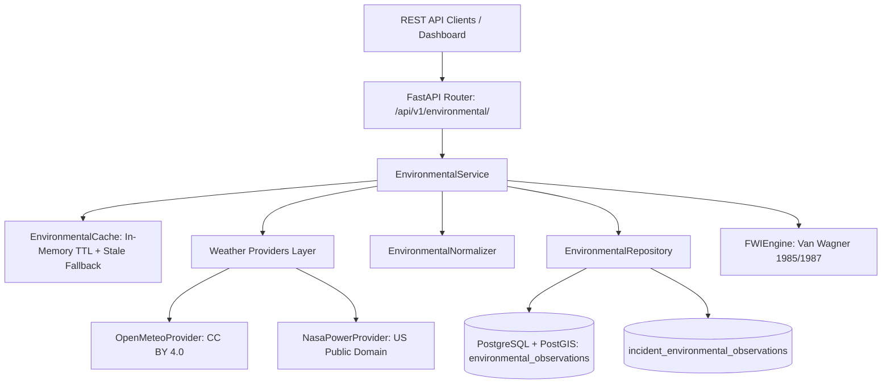

# SCOUT — Environmental Data Integration Architecture (Milestone 09)

## 1. System Overview

The Environmental Data Integration Subsystem enables SCOUT to retrieve, validate, normalize, cache, query, and process real-time, forecast, and historical meteorological data from external atmospheric data providers.

The environmental subsystem directly feeds:
1. **Disaster Intelligence Engines:** Real-time atmospheric conditions (wind vector, humidity, temperature, surface pressure) parameterizing wildfire spread and flood forecasting.
2. **Geospatial Exposure Analysis:** Downwind risk projection correlating wind vectors with exposed critical infrastructure and vulnerable populations.
3. **Fire Weather Index (FWI) Subsystem:** Canadian Forest Service fire danger rating computations supporting wildfire hazard modeling.



---

## 2. Scientific Data Provenance & Typology Taxonomy

Environmental observations are strictly partitioned into five immutable scientific typologies:

| Typology | Scientific Origin | Primary Source | Time Semantics | DB Constraints Enforced |
| :--- | :--- | :--- | :--- | :--- |
| `station_observed` | Physical in-situ weather stations / sensors | Ground telemetry (IMD, WMO) | Valid observation timestamp | Unique per station, valid time |
| `reanalysis` | Atmospheric assimilation / historical modeling | ERA5-Land, MERRA-2 | Retrospective hourly/daily step | Unique per grid cell, model, valid time |
| `model_analysis` | High-frequency NWP analysis / nowcasts | Open-Meteo best-match (ICON, ECMWF) | Current nowcast valid time | Unique per grid cell, model, valid time |
| `forecast` | Numerical weather prediction forward simulations | ECMWF IFS, NOAA GFS, DWD ICON | Forecast valid time + cycle init time | Unique per grid, model, valid time, init time, lead hours |
| `derived` | Computed physical or empirical indices | CFS-FWI Engine, VPD algorithms | Calculation valid time | Unique per location, algorithm, version, source fingerprint |

> [!IMPORTANT]
> **Open-Meteo Current Conditions:** Derived from Numerical Weather Prediction (NWP) model analyses and spatial nowcasting interpolations. They are **never** classified as ground observations.
> **NASA POWER Reanalysis:** Derived from NASA GMAO MERRA-2 atmospheric assimilation and CERES satellite processing. The API defaults to Local Solar Time (`LST`); the adapter mandates `time-standard=UTC` on all requests.

---

## 3. Database Schema Evolution & Identity Architecture

### 3.1 Observation Bundle Design
Rather than an Entity-Attribute-Value (EAV) model, SCOUT implements an **Atmospheric State Bundle** where a single row captures the co-located atmospheric state:
- `temperature_celsius`
- `relative_humidity`
- `wind_speed_mps`
- `wind_direction_degrees`
- `precipitation_mm`
- `surface_pressure_hpa`
- `metrics_payload` (extensible JSONB)

This design maintains full backward compatibility with `hazard_predictions.primary_observation_id` (foreign key pointing directly to the snapshot initializing wildfire simulations) and allows $O(1)$ state retrieval.

### 3.2 Canonical Namespaced Location Identity
Locations are decoupled into requested and resolved coordinates:
- `requested_latitude`, `requested_longitude`: Exact coordinates requested by the client.
- `resolved_latitude`, `resolved_longitude`: Grid center or station coordinates resolved by the provider.
- `location_id`: Canonical deterministic string formatted to 4 decimal places (~11m):
  - Gridded: `grid:{provider}:{model}:{resolved_lat_4dp}_{resolved_lon_4dp}`
  - Station: `station:{provider}:{station_code}`
  - Point: `point:{lat_4dp}_{lon_4dp}`

### 3.3 Partial Unique Indexes (PostgreSQL)
To prevent cross-provider and cross-model collisions while preserving distinct forecast cycles:

```sql
-- 1. In-situ and Historical Reanalysis
CREATE UNIQUE INDEX uq_env_obs_ground_and_reanalysis
ON environmental_observations (location_type, location_id, provider, dataset_or_model, typology, valid_time_utc)
WHERE typology IN ('station_observed', 'reanalysis');

-- 2. Model Analysis / Nowcasts
CREATE UNIQUE INDEX uq_env_obs_model_analysis
ON environmental_observations (location_type, location_id, provider, dataset_or_model, valid_time_utc)
WHERE typology = 'model_analysis';

-- 3. NWP Forecast Cycles
CREATE UNIQUE INDEX uq_env_obs_forecast
ON environmental_observations (location_type, location_id, provider, dataset_or_model, valid_time_utc, init_time_utc, lead_time_hours)
WHERE typology = 'forecast';

-- 4. Derived Indices
CREATE UNIQUE INDEX uq_env_obs_derived
ON environmental_observations (location_type, location_id, algorithm_name, algorithm_version, valid_time_utc, source_fingerprint)
WHERE typology = 'derived';
```

---

## 4. Canadian Forest Fire Weather Index (FWI) Engine

### 4.1 Implementation Standards & Tropical Methodology
The FWI engine implements the recursive fuel moisture and fire behavior equations from Van Wagner & Pickett (1985, FTR 33) and Van Wagner (1987, Forestry Technical Report 35):
1. **Fine Fuel Moisture Code (FFMC):** Fast-drying surface litter and fine cured fuel moisture [0, 101].
2. **Duff Moisture Code (DMC):** Moderately deep organic duff layers [0, $\infty$).
3. **Drought Code (DC):** Deep compact organic matter long-term drought [0, $\infty$).
4. **Initial Spread Index (ISI):** Potential rate of forward fire spread combining wind and FFMC [0, $\infty$).
5. **Buildup Index (BUI):** Total fuel available for combustion combining DMC and DC [0, $\infty$).
6. **Fire Weather Index (FWI):** Integrated fire intensity potential combining ISI and BUI [0, $\infty$).
7. **Daily Severity Rating (DSR):** Non-linear power transform of FWI representing control difficulty: $\text{DSR} = 0.0272 \times \text{FWI}^{1.77}$.

**Tropical Daylength Methodology:**
In equatorial and tropical bands (latitudes between $-30^\circ$ and $+30^\circ$, including central and southern India), the engine implements the official Canadian Forest Service international standard constants ($L_e = 9.0\text{ hours}$ for DMC, $L_f = 1.39$ for DC) established by W.J. de Groot et al. (2007) for tropical Fire Danger Rating Systems (e.g. Indonesian/Malaysian FDRS).

### 4.2 Benchmark Verification & Scope
The engine is validated against independent published ground truth from:
- **Primary Source:** Natural Resources Canada / Canadian Forest Service Information Report NOR-X-424 (2015), *Updated source code for calculating fire danger indices in the Canadian Forest Fire Weather Index System*, by Y. Wang, K.R. Anderson, and R.M. Suddaby, Northern Forestry Centre, Edmonton, AB. Table 7, page 11 (Fo133-1/424E-PDF, ISBN 978-1-100-25747-1). URL: `https://cfs.nrcan.gc.ca/pubwarehouse/pdfs/36025.pdf`.
- **Foundational Reference:** C.E. Van Wagner and T.L. Pickett (1985), Forestry Technical Report 33 (Fo64-33/1985E).

**Benchmark Scope Transparency:**
- **Independently Verified Scope:** Exactly 5 consecutive days (April 13–17, 1985) have verbatim published independent numerical outputs in NOR-X-424 Table 7.
- **Unrounded Numerical Precision:** Across all 5 benchmark days and all 7 variables (FFMC, DMC, DC, ISI, BUI, FWI, DSR), unrounded engine calculations agree with published values with an absolute error $\le 0.048$ ($\le 0.05$). All rounded outputs match verbatim to $0.00$.
- **Continuous Multi-Week Series:** Data beyond Day 5 serves as internal regression benchmarking.

### 4.3 Timeseries Gap Detection & Sequence Integrity
Recursive FWI moisture calculations maintain multi-day exponential memory (up to 52 days for the Drought Code). Missing calendar days silently distort recursive calculations. `FWIEngine.calculate_series()` (and alias `calculate_timeseries()`) enforces:
- **Consecutive Calendar Days:** Enforces $(\text{date}_{i} - \text{date}_{i-1}) = 1\text{ day}$. Raises `FWITimeseriesGapError` if missing days occur under default `strict_consecutive=True`.
- **Duplicate & Inversion Rejection:** Rejects duplicate calendar dates and chronologically inverted readings with `FWITimeseriesGapError`.
- **No Automated Fabrication:** Never fabricates or interpolates weather observations automatically.

### 4.4 Operational Danger Rating Thresholds & Calibration Notice
- **Low:** $\text{FWI} < 5.2$
- **Moderate:** $5.2 \le \text{FWI} < 11.2$
- **High:** $11.2 \le \text{FWI} < 21.3$
- **Very High:** $21.3 \le \text{FWI} < 38.0$
- **Extreme:** $\text{FWI} \ge 38.0$

> [!WARNING]
> **Indian Regional Calibration Required:** These standard danger rating cutoffs are derived from Canadian boreal pine fuel complexes (*Pinus banksiana* / *Pinus contorta*). Indian agro-ecological zones (e.g. tropical deciduous Sal and Teak forests, Western Ghats evergreen, and Himalayan chir pine) exhibit different fuel chemistry, leaf shedding, and moisture regimes. Danger thresholds must be calibrated against Forest Survey of India (FSI) MODIS/VIIRS fire detections before operational civil defense use.

---

## 5. Reliability & Layered Caching

### 5.1 Caching Strategy
- **Current Conditions (`model_analysis`):** TTL = 30 minutes (1800s).
- **Forecast Projections (`forecast`):** TTL = 2 hours (7200s).
- **Historical Reanalysis (`reanalysis`):** TTL = 24 hours (86400s).

### 5.2 Stale-on-Error Fallback
If external provider APIs experience outages, timeouts (5.0s), or rate limits (HTTP 429), `EnvironmentalService` retrieves the most recent expired cache entry and serves it with `is_stale: true`. This prevents transient external failures from degrading SCOUT incident response operations.

---

## 6. Geospatial Runtime Context & Database Verification Status

### 6.1 Geographic Context Catalog Reality
- `default_context_catalog` (`GeospatialContextCatalog`) is an in-memory spatial catalog.
- It starts **empty** upon application startup. No geographic features are pre-loaded from PostGIS at launch.
- Plume downwind exposure calculations require features to be registered explicitly or loaded via future persistent layer loaders (Milestone 10 dependency).

### 6.2 PostgreSQL / PostGIS Verification Status
- Database migrations (`20261031_0002_environmental_observations_upgrade.py`), nullable incident relationships, cascade association tables, and 4 partial unique indexes are verified via **offline SQL generation** and **SQLite mock tests**.
- **Live PostGIS Execution:** Unverified due to absence of an active PostgreSQL daemon on port 5432 in the test environment. Real database concurrency and partial index enforcement must be validated in containerized staging.

---

## 7. API Endpoints Reference

All endpoints are registered under `/api/v1/environmental`:

| Method | Path | Summary | Return Type |
| :--- | :--- | :--- | :--- |
| `GET` | `/health` | Subsystem and provider health check | `Dict[str, Any]` |
| `GET` | `/current` | Current atmospheric conditions | `EnvironmentalObservationItem` |
| `GET` | `/forecast` | Hourly weather forecast time series | `List[EnvironmentalObservationItem]` |
| `GET` | `/historical` | Historical ERA5/MERRA-2 reanalysis | `List[EnvironmentalObservationItem]` |
| `POST` | `/ingest` | On-demand retrieval and DB persistence | `EnvironmentalIngestResponse` |
| `GET` | `/observations` | Query persisted observations | `List[EnvironmentalObservationItem]` |
| `POST` | `/fwi/calculate` | Canadian Fire Weather Index computation | `FWICalculateResponse` |

---

## 8. Licensing & Attribution Notice

- **Open-Meteo:** Meteorological data provided by Open-Meteo.com under Creative Commons Attribution 4.0 International (CC BY 4.0).
  *Notice:* The free tier of Open-Meteo is strictly for non-commercial evaluation and personal research. Operational commercial deployments require an Open-Meteo commercial subscription plan or a self-hosted instance.
- **NASA POWER:** Atmospheric reanalysis data provided by NASA Langley Research Center POWER Project / GMAO MERRA-2 Assimilation (United States Public Domain). Data is available hourly from 2001-01-01 and daily from 1981-01-01. Requests mandate UTC `time-standard=UTC`.
- **Canadian Forest Fire Weather Index (FWI):** Equations derived from Canadian Forestry Service publications (Van Wagner 1985, 1987). Regional calibration against local ecosystems (e.g. Indian Forest Survey data) is required before operational field deployment.
