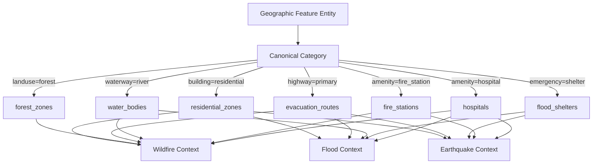

# SCOUT — Geographic Data Sources & Area of Interest Specification
## Architectural Reference for Persistent Geospatial Data Integration (Milestone 10)

**Date:** 2026-10-31  
**Project:** SCOUT — Multimodal Disaster Intelligence & Response Platform  
**Subsystem:** Persistent Geospatial Intelligence (M10)  
**Status:** Architecture Specification & Source Evaluation  

---

## 1. Architectural Purpose & Motivation

Milestone 08 established SCOUT's core spatial calculation engine (coordinate validation, geodesic metric distance projections, topological relationships, exposure scoring, and risk assessment). However, its runtime relied on an in-memory catalog (`default_context_catalog`) that initialized empty on application launch.

Milestone 10 establishes **PostgreSQL + PostGIS as the persistent source of truth** for real-world geographic features. 

### Architectural Core Principles
1. **PostGIS as Source of Truth:** Geographic features are stored in relational PostGIS tables indexed with spatial GiST indexes and B-tree compound keys.
2. **No Unbounded Memory Loading:** An entire country or state's geographic database is **never** loaded into application memory. Instead, spatial queries are strictly bounded by bounding boxes (`ST_MakeEnvelope`), search radii (`ST_DWithin`), layer filters, category filters, and limit/offset pagination.
3. **Strict Provenance & Traceability:** Every stored feature links to a registered `GeographicDataSource` and `GeographicIngestionRun`, preserving the exact upstream license, attribution, source feature identifier, and original attributes.
4. **Multi-Hazard Extensibility:** Features are categorized canonically (`hospitals`, `water_bodies`, `residential_zones`, etc.) and mapped to multiple relevant disaster categories (`wildfire`, `flood`, `earthquake`), preventing disjoint hazard silos.

---

## 2. Research & Evaluation of Geographic Data Sources

### 2.1 Candidate Source Evaluation

| Source / Provider | Products & Datasets | Coverage | Format / Access | License & Terms | Attribution Required | Evaluation Verdict |
| :--- | :--- | :--- | :--- | :--- | :--- | :--- |
| **OpenStreetMap (OSM)** *(OSMF / Geofabrik)* | Critical infrastructure (hospitals, schools, fire stations), roads, waterways, buildings, land use | Global (including comprehensive India extracts) | Geofabrik `.osm.pbf` regional extracts, Overpass API GeoJSON extracts | Open Database License (ODbL 1.0) | "© OpenStreetMap contributors" | **`APPROVED`** (Primary vector source for infrastructure, transport & waterways) |
| **Global Human Settlement Layer (GHSL)** *(European Commission JRC)* | GHS-BUILT-S (built-up surface at 10m/100m), GHS-POP (population density at 100m/1km) | Global | Cloud-Optimized GeoTIFF (COG), WMS / WFS services | Creative Commons Attribution 4.0 (CC BY 4.0) | "European Commission, Joint Research Centre (JRC)" | **`APPROVED FOR EVALUATION`** (Raster demographic grids for M11+ exposure scaling) |
| **ESA WorldCover** *(European Space Agency)* | 10m Land Cover / Land Use (Tree cover, Shrubland, Grassland, Built-up, Water) | Global | Cloud-Optimized GeoTIFF (COG), Terrascope S3 bucket | Creative Commons Attribution 4.0 (CC BY 4.0) | "© ESA WorldCover project / contains modified Copernicus Sentinel data" | **`APPROVED FOR EVALUATION`** (Vegetation fuel classification for wildfire spread) |
| **Copernicus DEM (GLO-30)** *(ESA / Airbus)* | 30m Digital Elevation Model, surface heights, slope, drainage terrain | Global (non-polar) | Cloud-Optimized GeoTIFF via AWS Open Data / Planetary Computer | Open Access for scientific and commercial use | "© DLR e.V. 2010-2014 and © Airbus Defence and Space GmbH" | **`APPROVED FOR EVALUATION`** (Terrain slope & hydrological drainage modeling) |
| **NASA SRTM v3.0** *(NASA JPL)* | 1 arc-second (~30m) Digital Elevation Model, EGM96 vertical datum | Global ($60^\circ\text{N}$ to $56^\circ\text{S}$) | HGT files, GeoTIFF via USGS EarthExplorer / LP DAAC | United States Public Domain | "NASA Jet Propulsion Laboratory / USGS" | **`APPROVED FOR EVALUATION`** (Historical baseline elevation & slope) |
| **Bhuvan Geoportal** *(ISRO / NRSC India)* | National Land Use/Land Cover (LULC), flood inundation maps, disaster support services | India national & state coverage | OGC WMS/WFS, Bhuvan Web API, Disaster Services portal | Government of India Restricted / Non-commercial academic use | "ISRO / National Remote Sensing Centre (NRSC), Government of India" | **`RESTRICTED`** (Proprietary terms, token requirements; suitable for downstream enterprise deployments) |
| **Survey of India (SOI)** *(Department of Science & Tech)* | Open Series Maps (OSM 1:50,000 toposheet vector data), administrative boundaries | India | SOI GeoPortal (Nakshe portal), PDF/Shapefile | National Map Policy (NMP) 2005 / Geospatial Guidelines 2021 | "Survey of India, Department of Science and Technology" | **`RESTRICTED`** (Authentication and registration required; not suitable for automated public CLI ingestion) |
| **Open City / data.gov.in** *(NIC / Data.gov.in)* | City master plans, municipal boundaries, ward-level ward maps | Urban India (Delhi, Mumbai, Bengaluru, Chennai) | GeoJSON, Shapefile, CSV | National Data Sharing and Accessibility Policy (NDSAP) | "Government of India / Municipal Corporation via data.gov.in" | **`APPROVED`** (Urban municipal emergency infrastructure validation) |

---

## 3. Detailed Source Profiles & Data Quality Analysis

### 3.1 OpenStreetMap (OSM)
- **Feature Categories:**
  - Emergency Infrastructure: `amenity=hospital`, `amenity=clinic`, `amenity=fire_station`, `emergency=shelter`, `amenity=police`.
  - Educational / Community Assembly: `amenity=school`, `amenity=college`, `amenity=university`, `building=public`.
  - Transport & Evacuation: `highway=motorway`, `highway=trunk`, `highway=primary`, `highway=secondary`.
  - Hydrology & Water Bodies: `waterway=river`, `waterway=stream`, `waterway=canal`, `natural=water`, `water=lake`.
  - Land Cover & Forestry: `landuse=forest`, `natural=wood`, `leisure=park`.
- **Known Quality Limitations:**
  - High fidelity in urban centers; coverage degrades in rural tribal districts and forest reserves.
  - Tagging consistency varies (e.g. `emergency=shelter` is under-tagged in India; municipal flood shelters are frequently tagged simply as `amenity=school` or `amenity=community_centre`).
  - Positional accuracy is typically within 5–15 meters (derived from consumer GPS and satellite imagery alignment).
- **Ingestion Interchange:** Vector GeoJSON FeatureCollections extracted via Overpass QL or converted from Geofabrik `.osm.pbf` via Osmium / GDAL.

### 3.2 Global Human Settlement Layer (GHSL)
- **Product:** GHS-POP R2023A (Global Human Settlement Population Grid).
- **Spatial Resolution:** 100 meters (World Mollweide projection) and 3 arc-seconds (~100m in WGS84).
- **Utility:** Provides objective resident population estimates within an incident exposure radius, replacing arbitrary population heuristics.
- **Handling:** Evaluated as a raster surface; conversion to aggregated vector exposure zones (settlement density polygons) scheduled for Milestone 11.

### 3.3 Copernicus DEM (GLO-30)
- **Product:** 30m Global Digital Surface Model.
- **Utility:** Provides elevation and derived terrain slope angles for flood accumulation zones and landslide susceptibility.
- **Handling:** Raster DEM; vector point sampling or polygon zonal statistics will interface via dedicated raster worker nodes in subsequent milestones.

---

## 4. Multi-Hazard Feature Category to Disaster Taxonomy

A single real-world geographic entity often possesses critical significance across multiple disaster categories. SCOUT implements a normalized multi-hazard mapping:

| Canonical Feature Category | Target Feature Classes | Hazard Relevance Mapping | Exposure Significance |
| :--- | :--- | :--- | :--- |
| `hospitals` | Acute hospitals, primary health centers (PHC), trauma centers | `["wildfire", "flood", "earthquake"]` | Critical life-support asset requiring priority evacuation protection or emergency dispatch access. |
| `fire_stations` | Municipal and industrial fire stations | `["wildfire", "earthquake"]` | First-responder operational staging node; vulnerable to seismic structural collapse or road cutoff. |
| `flood_shelters` | Designated cyclone/flood shelters, community halls | `["flood", "earthquake"]` | Safe congregation nodes; flood inundation of access roads isolates evacuees. |
| `schools` | Schools, universities, day-care centers | `["earthquake", "flood"]` | High daytime child population vulnerability; secondary temporary shelter facilities. |
| `residential_zones` | High-density urban settlements, residential wards | `["wildfire", "flood", "earthquake"]` | Primary civilian exposure centers determining casualty risk and shelter capacity requirements. |
| `water_bodies` | Rivers, reservoirs, retention ponds, lakes | `["wildfire", "flood"]` | Water supply for aerial/ground wildfire suppression; flood inundation sources during surge. |
| `evacuation_routes` | Major highways, trunk roads, arterial bridges | `["wildfire", "flood", "earthquake"]` | Ingress for emergency services; egress for evacuations; vulnerable to flood submergence or bridge collapse. |
| `forest_zones` | Reserved forests, dense vegetation, tree cover | `["wildfire"]` | High-combustion fuel source parameterizing wildfire spread and flame-front intensity. |
| `emergency_services` | Police stations, civil defense headquarters, NDRF battalions | `["wildfire", "flood", "earthquake"]` | Command, control, and rescue deployment coordination centers. |
| `critical_infrastructure`| Power substations, water treatment facilities, telecom towers | `["wildfire", "flood", "earthquake"]` | Utility lifeline assets whose disruption triggers cascade systemic failures. |

---

## 5. Configurable Area of Interest (AOI) Specification

### 5.1 Project AOI Policy
SCOUT does **not** hardcode a single geographic district or attempt to download a multi-gigabyte national dataset without user consent. The ingestion architecture supports **dynamic, user-specified Areas of Interest (AOI)**.

An AOI is defined by:
1. **`aoi_name`:** Human-readable geographic descriptor (e.g., `dehradun_valley`, `delhi_nct`, `wayanad_district`).
2. **`bounding_box`:** Standard WGS84 bounding rectangle `[min_longitude, min_latitude, max_longitude, max_latitude]`.
3. **`state_or_country`:** Administrative jurisdiction code (e.g. `IN-UT` for Uttarakhand, India).

### 5.2 Reference Calibration AOI: Dehradun & Western Himalayan Foothills
For initial end-to-end integration testing, SCOUT establishes a verified multi-hazard calibration AOI:
- **Identifier:** `in_dehradun_basin`
- **Location:** Dehradun Valley and Rajaji National Park fringe, Uttarakhand, India.
- **Bounding Box:** `[77.9000, 30.1500, 78.2000, 30.4500]`
- **Multi-Hazard Profile:**
  - *Wildfire Risk:* Pine-oak forest reserves with severe pre-monsoon fire history.
  - *Flood Risk:* Seasonal monsoonal river swelling (Song and Asan rivers) and flash floods.
  - *Earthquake Risk:* Seismic Zone IV/V Himalayan active fault boundary.

---

## 6. Current Source Status Categorization

To maintain complete architectural integrity, data sources are explicitly categorized into four distinct statuses:

### Category 1: Evaluated Sources (Research Complete)
- OpenStreetMap via Geofabrik / Overpass.
- Global Human Settlement Layer (GHSL R2023A).
- ESA WorldCover 10m.
- Copernicus GLO-30 DEM.
- NASA SRTM v3.0.
- ISRO Bhuvan & Survey of India Geoportals.

### Category 2: Approved Ingestion Sources & Formats
- **OpenStreetMap GeoJSON / Overpass Extracts:** Approved for vector infrastructure, transport, hydrology, and forest layers.
- **GeoJSON FeatureCollection Interchange:** Approved as the primary standard vector ingest format.

### Category 3: Synthetic Calibration Test Fixtures
- **Calibration Fixture File:** `data/geospatial/calibration_dehradun_features.geojson`
- **Dataset Status:** `synthetic_test_fixture` (operational use prohibited).
- **Geometric Fidelity:** Idealized axis-aligned rectangular boxes for polygons and 4-to-5 point line approximations for waterways.
- **Identifier Provenance:** Synthetic sequential IDs (`osm_node_1001` through `osm_poly_3004`), not traceable to real upstream OpenStreetMap entity node/way IDs.
- **Intended Purpose:** Geometric validation of the bounded batch ingestion pipeline, topological relationship resolvers, and GiST spatial index query structures.
- **Operational Warning:** Completely unsuitable for operational disaster response. Operational deployments must ingest authenticated OSM Overpass QL extracts or Geofabrik `.osm.pbf` packages.

### Category 4: Successfully Ingested Real-World Layers
- *Status:* Real-world database persistence and spatial GiST index execution will be achieved via the M10 CLI ingestion pipeline.
- *Notice:* SCOUT does not claim national India coverage until specific district packages are formally ingested and verified via the administrative CLI.

---

## 7. Licensing & Attribution Compliance Checklist

| Provider / Source | License | Redistribution Conditions | Required Attribution Text in API / UI |
| :--- | :--- | :--- | :--- |
| **OpenStreetMap** | Open Database License (ODbL 1.0) | Share-Alike on derivative databases; preserve credit on data extracts. | `Data © OpenStreetMap contributors, ODbL 1.0 (https://www.openstreetmap.org/copyright)` |
| **ESA WorldCover** | Creative Commons Attribution 4.0 (CC BY 4.0) | Unrestricted commercial/non-commercial with attribution. | `© ESA WorldCover project 2021 / contains modified Copernicus Sentinel data` |
| **GHSL (JRC)** | Creative Commons Attribution 4.0 (CC BY 4.0) | Open access with credit to European Commission JRC. | `European Commission, Joint Research Centre (JRC) Global Human Settlement Layer` |
| **Copernicus DEM** | Open Access (Copernicus Data Policy) | Free distribution with attribution to DLR and Airbus. | `© DLR e.V. and © Airbus Defence and Space GmbH (Copernicus DEM)` |

---

## 8. Database Fallback Semantics & Geographic Data Provider Attribution

To prevent silent fallback masking and guarantee transparent provenance across the geospatial subsystem:

### 8.1 Fallback Decision Matrix
1. **Case A (Database Succeeded with Features):**
   - The database returns matching features within the bounding perimeter.
   - Returned directly with `data_provider="postgis_spatial_db"`.
2. **Case B (Database Succeeded with Zero Features):**
   - The database executed successfully but found 0 matching entities.
   - An empty feature list `[]` is returned with `data_provider="postgis_spatial_db"`.
   - Contributing factors explicitly record that no entities were found in the *persistent spatial database*.
   - **Crucial Invariant:** The service **never** silently falls back to the in-memory catalog, which would falsely present mock catalog assets as real database data.
3. **Case C (Database Connection or Query Failure):**
   - If PostgreSQL/PostGIS is disconnected, times out, or encounters SQL syntax/execution errors, the exception is logged at `ERROR` level and re-raised as `PostGISUnavailableError` (HTTP 503).
   - **Crucial Invariant:** Database exceptions are **never** swallowed or demoted to `DEBUG`, and never silently masked by falling back to the local catalog.
4. **Case D (Explicit In-Memory / Unconfigured Mode):**
   - When callers explicitly pass `db=None` (or when running standalone CLI tools in local mode), the service queries `default_context_catalog` and attributes responses to `data_provider="local_vector_catalog"`.

### 8.2 Assessor Attribution Alignment
All disaster-specific risk assessors (`WildfireRiskAssessor`, `FloodRiskAssessor`, `EarthquakeRiskAssessor`) accept the dynamic `data_provider` parameter from `GeospatialService` and propagate it into `GeospatialAssessmentResponse.data_provider`.

---

## 9. Verification Status & Operational Readiness

| Verification Dimension | Status | Notes |
| :--- | :--- | :--- |
| **Data Normalizer & Geometry Engine** | **`VERIFIED`** | Full topology validation, Shapely `make_valid` repair, and UTM projection verified. |
| **Bounded Ingestion Pipeline** | **`VERIFIED`** | Batching, SHA-256 deduplication, dry-run simulation, and audit tracking verified. |
| **Geospatial Fallback Semantics** | **`VERIFIED`** | Conditions A, B, C, and D verified with unit and mock tests. |
| **Risk Assessor Attribution** | **`VERIFIED`** | `postgis_spatial_db` vs `local_vector_catalog` dynamic attribution verified. |
| **FastAPI Persistent REST API** | **`VERIFIED`** | Direct controller function testing executed in 0.13s avoiding Starlette TestClient Windows deadlocks. |
| **Live PostGIS Relational Execution** | **`NOT VERIFIED`** | Relational DDL and SQL verified against SQLite/PostGIS mock dialect; live Docker/PostgreSQL server execution was not audited. |
