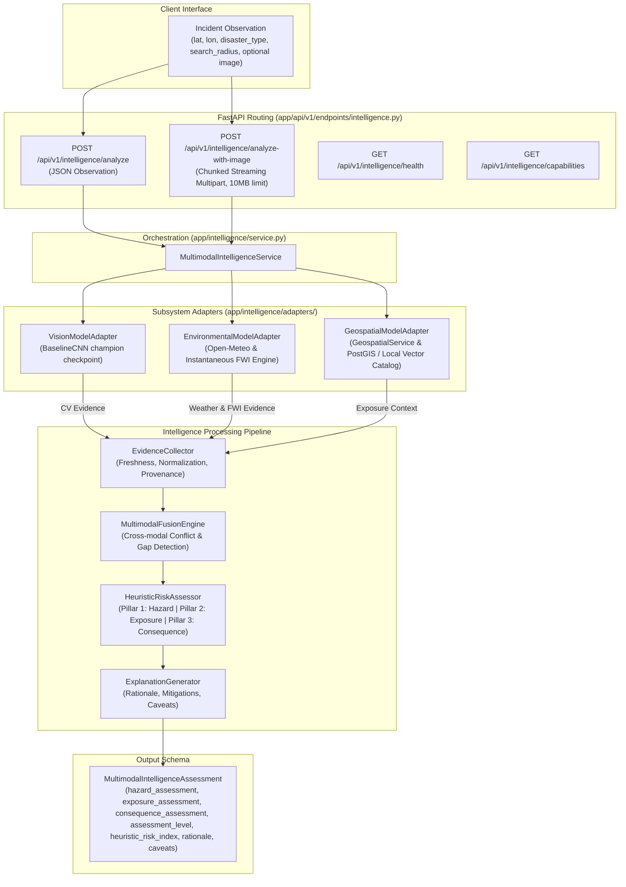

# SCOUT — Milestone 11 Architecture Document
## Multimodal Disaster Intelligence & Contextual Analysis Architecture

**Milestone:** M11 (Corrected & Hardened)  
**Status:** Completed & Validated  
**Version:** 1.1.0  
**Target Systems:** FastAPI Backend, PyTorch CV Engine (M07), Environmental Subsystem (M09), Geospatial Subsystem (M08/M10)  

---

## 1. System Overview & Purpose

Milestone 11 unifies the disaster intelligence capabilities developed across preceding milestones into an explainable, multimodal incident analysis engine. Rather than evaluating visual imagery, weather models, and spatial exposure as disconnected data silos, M11 provides a single cohesive intelligence layer in `backend/app/intelligence/`.

The system processes real-world disaster observations through a deterministic, explainable pipeline:

$$\text{Observation} \longrightarrow \text{Evidence Collection} \longrightarrow \text{Contextual Fusion} \longrightarrow \text{3-Pillar Hazard/Exposure/Consequence Assessment} \longrightarrow \text{Explainable Assessment Result}$$

### Core Design Principles
1. **Strict Separation of Hazard, Exposure, and Consequence:** Proximity to human settlements or infrastructure never creates active wildfire hazard. Active hazard is strictly derived from physical fire evidence (computer vision and atmospheric dryness proxies).
2. **Deterministic & Transparent:** Zero fabricated predictions, zero synthetic weather substitutions. When meteorological parameters are missing, FWI is omitted rather than computed from arbitrary defaults.
3. **Scientific Attribution & Caveats:** Single-observation weather is explicitly qualified as an *instantaneous atmospheric combustibility indicator*, not a complete multi-day Canadian Forest Service FWI.
4. **Preservation of M10 PostGIS Contracts:** Configured PostGIS database failures propagate explicit `PostGISUnavailableError` (HTTP 503) and are never silently swallowed or masked.
5. **Robust Ingestion Hardening:** Multipart uploads are validated via chunked streaming (64KB chunks) bounded by `settings.MAX_UPLOAD_SIZE_BYTES` (10MB) with upfront magic byte signature checks.
6. **Strict ML Model & Checkpoint Preservation:** M07 vision models (`BaselineCNN` (`ml/models/baseline_cnn.py`)) and trained weights in `artifacts/checkpoints/` are preserved byte-for-byte without retraining or fine-tuning.

---

## 2. Multimodal Architecture Diagram

---

## 3. Subsystem Integration & Adapters

### 3.1 Computer Vision Integration (M07)
- **Module:** [`app.intelligence.adapters.vision_adapter.VisionModelAdapter`](../../backend/app/intelligence/adapters/vision_adapter.py)
- **Champion Checkpoint:** `artifacts/checkpoints/m07_phase7c_v2/baseline_cnn_best.pt` (SHA-256: `3764999aa8e19ad27e5f31141a2f05b33c9920c49c4889117556b12ca18a2fd1`).
- **Target Classes:** `fire` (0), `neutral` (1), `smoke` (2).
- **Preprocessing:** M07 aspect-ratio-preserving letterbox resizing to $224 \times 224$ with ImageNet channel mean fill `(124, 116, 104)` via [`get_eval_transforms()`](../../ml/data/transforms.py).
- **Inference Mode:** Lazy evaluation on CPU with `torch.no_grad()`. Logits are converted to softmax probabilities:
  $$\sum_{c \in \{\text{fire}, \text{neutral}, \text{smoke}\}} P(c) = 1.0$$
- **Neutral Image Semantics:** When visual evidence confirms absence of flame and smoke ($P(\text{fire}) < 0.10$ and $P(\text{smoke}) < 0.10$), active hazard is clamped to zero or background potential.

### 3.2 Environmental & Canadian FWI Integration (M09)
- **Module:** [`app.intelligence.adapters.environmental_adapter.EnvironmentalModelAdapter`](../../backend/app/intelligence/adapters/environmental_adapter.py)
- **Service Reused:** [`EnvironmentalService`](../../backend/app/environmental/services.py) and [`FWIEngine`](../../backend/app/environmental/fwi/engine.py).
- **Zero Default Constant Rule:** Default fallbacks ($20^\circ\text{C}$, $50\%$ RH, $3\text{ m/s}$, $0\text{ mm}$ rain) are strictly eliminated. If any required variable is missing, FWI calculation is skipped, `fwi_available = False`, and `missing_meteorological_variables` records the absent inputs.
- **Scientific Attribution:** Computed FWI is categorized as `instantaneous_weather_indicator (experimental_uninitialized_fwi)` with explicit caveats stating the absence of 12:00 LST standardization, 24h rainfall history, and consecutive multi-day moisture code tracking.

### 3.3 Geospatial Exposure Integration (M08 & M10)
- **Module:** [`app.intelligence.adapters.geospatial_adapter.GeospatialModelAdapter`](../../backend/app/intelligence/adapters/geospatial_adapter.py)
- **Local Catalog Bootstrap:** On initialization, [`GeographicContextCatalog`](../../backend/app/geospatial/context.py) automatically bootstraps verified calibration entities from `data/geospatial/calibration_dehradun_features.geojson` (13 features: Doon Hospital, Dehradun Fire Station, Dehradun Core Settlement, transport corridors, rivers).
- **Strict M10 Contract Preservation:** When a database session is configured (`db is not None`), PostGIS query failures raise `PostGISUnavailableError` and are never silently swallowed into empty local summaries.

---

## 4. Evidence Fusion & Cross-Modal Conflict Engine

The [`MultimodalFusionEngine`](../../backend/app/intelligence/fusion.py) evaluates cross-modal coherence before threat assessment:

1. **Gap Analysis:** Identifies missing modalities (`computer_vision_imagery`, `environmental_weather_and_fwi`, `geospatial_exposure_catalog`).
2. **Freshness Tracking:** Identifies stale data sources and records degradation.
3. **Cross-Modal Contradiction Detection:**
   - **Precipitation vs. Flame:** High flame detection ($P(\text{fire}) > 0.80$) coinciding with significant rainfall ($> 10.0\text{ mm}$).
   - **Sub-zero High Humidity vs. Flame:** High flame probability ($P(\text{fire}) > 0.85$) under freezing temperatures ($< -5.0^\circ\text{C}$) and near-saturation humidity ($> 90\%$).
   - **Extreme FWI vs. Neutral Visuals:** Extreme Fire Weather Index ($\text{FWI} > 40.0$) while image evidence shows zero flame or smoke ($P(\text{neutral}) > 0.95$).

---

## 5. 3-Pillar Risk Assessment Methodology

The [`HeuristicRiskAssessor`](../../backend/app/intelligence/risk.py) replaces the prior additive formulation with a mathematically sound 3-pillar interaction model:

### 5.1 Pillar 1: Hazard Assessment ($S_{\text{haz}} \in [0.0, 100.0]$)
Derived strictly from direct hazard observations:
- **Visual Evidence ($V \in [0.0, 100.0]$):**
  $$V = \min\left(100.0, \, 100 \cdot P(\text{fire}) + 50 \cdot P(\text{smoke})\right)$$
- **Atmospheric Combustibility ($E \in [0.0, 100.0]$):**
  $$E = \min\left(100.0, \, 2.5 \cdot \text{FWI}\right) \quad \text{or rule-based dryness if FWI missing}$$
- **Combined Hazard Score:**
  - If both visual and environmental:
    - If visual is neutral ($P(\text{fire}) < 0.10, P(\text{smoke}) < 0.10$):
      $$S_{\text{haz}} = \begin{cases} 0.0 & \text{if } E < 40.0 \\ \min(20.0, \, 0.20 \cdot E) & \text{if } E \ge 40.0 \end{cases}$$
    - Else:
      $$S_{\text{haz}} = 0.65 \cdot V + 0.35 \cdot E$$
  - If only visual: $S_{\text{haz}} = V$ (or $0.0$ if neutral)
  - If only environmental: $S_{\text{haz}} = E$
- **Hazard Level:**
  - `CRITICAL`: $S_{\text{haz}} \ge 70.0$
  - `HIGH`: $45.0 \le S_{\text{haz}} < 70.0$
  - `MODERATE`: $20.0 \le S_{\text{haz}} < 45.0$
  - `LOW`: $S_{\text{haz}} < 20.0$

### 5.2 Pillar 2: Exposure Assessment ($S_{\text{exp}} \in [0.0, 100.0]$)
Derived strictly from spatial infrastructure surrounding the coordinates:
- Base from settlement distance:
  $$S_{\text{base}} = \begin{cases} 
  70.0 & \text{if } d_{\text{settlement}} < 1000\text{ m} \\ 
  45.0 & \text{if } 1000\text{ m} \le d_{\text{settlement}} < 3000\text{ m} \\ 
  25.0 & \text{if } 3000\text{ m} \le d_{\text{settlement}} < 5000\text{ m} \\ 
  10.0 & \text{if } d_{\text{settlement}} \ge 5000\text{ m} \text{ or none found} 
  \end{cases}$$
- Vulnerability escalations:
  $$S_{\text{exp}} = \text{clamp}_{[0, 100]}\left(S_{\text{base}} + 15.0 \cdot \mathbb{I}(d_{\text{hospital}} < 2000\text{m}) + 5.0 \cdot \mathbb{I}(N_{\text{roads}} > 0) - 10.0 \cdot \mathbb{I}(N_{\text{water}} > 0) - 5.0 \cdot \mathbb{I}(d_{\text{fire\_station}} < 3000\text{m})\right)$$
- **Exposure Level:**
  - `CRITICAL`: $S_{\text{exp}} \ge 70.0$
  - `HIGH`: $45.0 \le S_{\text{exp}} < 70.0$
  - `MODERATE`: $20.0 \le S_{\text{exp}} < 45.0$
  - `LOW`: $S_{\text{exp}} < 20.0$

### 5.3 Pillar 3: Consequence Assessment ($S_{\text{con}} \in [0.0, 100.0]$)
Consequence reflects the potential impact of active hazard intersecting vulnerable exposure:
$$S_{\text{con}} = S_{\text{haz}} \cdot \left(\frac{S_{\text{exp}}}{100.0}\right)$$
- **Consequence Tier:**
  - If $S_{\text{haz}} == 0.0$: Consequence is $0.0$ (`LOW`) regardless of proximity to cities or hospitals.
  - `CRITICAL`: $S_{\text{con}} \ge 65.0$
  - `HIGH`: $35.0 \le S_{\text{con}} < 65.0$
  - `MODERATE`: $10.0 \le S_{\text{con}} < 35.0$
  - `LOW`: $S_{\text{con}} < 10.0$

### 5.4 Overall Threat Tier & Composite Index
- **Zero Hazard Rule:** If $S_{\text{haz}} == 0.0 \implies \text{Threat Level} = \text{LOW}$, $I_{\text{risk}} = 0.0$.
- **Low Hazard Rule:** If $S_{\text{haz}} < 20.0 \implies \text{Threat Level} = \text{LOW}$, $I_{\text{risk}} = \min(24.9, \, S_{\text{haz}} \cdot (0.8 + 0.2 \cdot S_{\text{exp}} / 100.0))$.
- **Moderate / High / Critical Hazard:**
  $$I_{\text{risk}} = 0.70 \cdot S_{\text{haz}} + 0.30 \cdot S_{\text{con}}$$
- **Critical Override:** If $P(\text{fire}) \ge 0.85$ and $d_{\text{settlement}} \le 1000\text{ m} \implies \text{Threat Level} = \text{CRITICAL}, \, I_{\text{risk}} \ge 75.0$.
- **Contradiction Cap (Correction D):** When `conflicting_streams` is non-empty and $P(\text{fire}) < 0.90$, candidate threat is capped at `MODERATE` ($I_{\text{risk}} \le 49.0$) and `uncertainty_qualification = HIGH_UNCERTAINTY` is attached.

---

## 6. API Interface Specification

Prefix: `/api/v1/intelligence`

### Endpoints:
1. `GET /api/v1/intelligence/health`
   - Returns operational status of CV model weights, weather providers, and spatial catalog.
2. `GET /api/v1/intelligence/capabilities`
   - Returns supported hazard categories, calibrated modalities, and scientific limitations.
3. `POST /api/v1/intelligence/analyze`
   - Accepts JSON `IncidentObservationInput`, returns `MultimodalIntelligenceAssessment`.
4. `POST /api/v1/intelligence/analyze-with-image`
   - Accepts multipart/form-data with raw raster image file (`UploadFile`) and coordinate fields.
   - Enforces 64KB chunked streaming, 10MB file limit (HTTP 413), magic byte format checks (HTTP 400), and empty file rejection (HTTP 400).

---

## 7. Known Limitations & Future Extensibility

1. **Heuristic Calibration vs. Probability:** The heuristic risk index is an empirical composite metric (0.0 to 100.0) designed for prioritization, NOT an empirical real-world probability.
2. **Regional FWI Calibration:** Canadian Forest Fire Weather Index equations are applied as standard; calibration against Indian tropical dry and moist deciduous forest fuels remains a future milestone.
3. **Flood & Earthquake Support:** Flood inundation (hydraulic modeling, DEM contouring) and seismic shake mapping (MMI, PGA) will be developed in future disaster-specific milestones.
4. **PostGIS Offline Verification:** When PostgreSQL port 5432 is unavailable, spatial analysis operates via local vector layers and in-memory catalogs. When a database session is configured, database connectivity errors are propagated as explicit HTTP 503 errors.
