# SCOUT — Milestone 12 Architecture Document
## Multi-Agent Disaster Response Workflow & LangGraph Implementation

**Milestone:** M12.5 (Coordinator Agent, Workflow Persistence & Public FastAPI Integration)  
**Status:** Completed & Validated  
**Version:** 1.5.0  
**Target Systems:** LangGraph Core, FastAPI Backend, SCOUT Multi-Agent Subsystem (`app.agents`), Database Persistence (`app.models.workflow`)  

---

## 1. System Overview & Why LangGraph is Introduced

SCOUT has developed specialized, production-grade analytical subsystems across preceding milestones:
- **M07:** Computer vision wildfire classification via deep convolutional neural networks (`BaselineCNN` (`ml/models/baseline_cnn.py`)).
- **M08 & M10:** Geospatial intelligence, spatial radius search, exposure analysis, and persistent PostGIS vector storage ([GeospatialService](../../backend/app/services/geospatial_service.py)).
- **M09:** Environmental data ingestion, atmospheric combustibility proxies, and Canadian Fire Weather Index equations ([FWIEngine](../../backend/app/environmental/fwi/engine.py)).
- **M11:** Multimodal contextual fusion, 3-pillar risk evaluation (Hazard, Exposure, Consequence), and structured explanation generation ([MultimodalIntelligenceService](../../backend/app/intelligence/service.py)).

While Milestone 11 unified these subsystems into an explainable multimodal assessment, operational disaster response demands multi-step orchestration that exceeds linear pipelines:
1. **Multi-Step Stateful Coordination:** Incident analysis and response require cyclic reasoning, state tracking, and progressive enrichment across heterogeneous data sources.
2. **Explicit Verification & Domain Guardrails:** Operational commands cannot execute without strict geographic and semantic validation.
3. **Evidence Provenance & Auditability:** Every recommendation, risk score, and dispatched action must maintain an unalterable audit trace recording which agent produced it, at what timestamp, and based on which verified observations.
4. **Human-in-the-Loop Boundaries:** High-consequence decisions (e.g., evacuation advisories, public warnings, asset mobilization) cannot be automated blindly; the system must suspend execution, await authorized human review, and resume safely.
5. **Resilient Failure Containment:** Downstream failures in external weather APIs or image processing must degrade gracefully rather than collapsing the entire emergency response session.

To satisfy these requirements, **LangGraph** (`langgraph>=1.2.0,<1.3.0`) is introduced as SCOUT's workflow orchestration engine. LangGraph provides:
- A cyclical directed graph execution model (`StateGraph`) built on stateful actors and immutable or reducer-managed state transitions.
- Typed state management with declarative reducers (`operator.add` accumulators) ensuring audit records and error envelopes are never overwritten.
- Native conditional routing for dynamic branching, early error termination, and human-approval gates.
- Persistent workflow snapshots stored in PostgreSQL via SQLAlchemy ORM models (`DisasterWorkflowRecord` and `WorkflowApprovalHistory`), backed by Alembic migration `0004_disaster_workflow_records`.

---

## 2. What an Agent Means in SCOUT

In SCOUT, an **Agent** is strictly defined as:
> **A specialized, deterministic, bounded computational actor with explicit typed inputs, structured schema outputs, domain-specific guardrails, and access to verifiable SCOUT subsystems.**

### What an Agent is NOT:
- **Not an ungrounded conversational chatbot:** SCOUT agents do not hallucinate facts, make arbitrary assumptions, or invent synthetic data.
- **Not a black-box autonomous actor:** Agents cannot take unverified real-world actions or alter database states outside their strict capability boundary.
- **Not a generator of fabricated predictions:** If input data is missing or invalid, agents record explicit gaps and omit calculations rather than substituting dummy defaults.

The core analytical computations (computer vision inference, FWI calculation, PostGIS spatial queries, risk indexing, response planning, and coordinator report synthesis) remain deterministic, code-governed algorithms.

---

## 3. The Logical Agents, Safety Gates & Public API

```mermaid
flowchart TD
    subgraph Ingestion ["1. Observation Ingestion & Validation (M12.1 - IMPLEMENTED)"]
        REQ["DisasterResponseWorkflowRequest<br/>(lat, lon, disaster_type, radius, observation, image)"]
        VAL["Validation Node (validate_request_node)<br/>(Coordinates, Radius, Supported Disaster Type)"]
    end

    subgraph Perception ["2. Domain Perception Agents (M12.2 - IMPLEMENTED)"]
        AG1["Agent 1: Intelligence Agent (intelligence_agent_node)<br/>(Reuses M11 MultimodalIntelligenceService)"]
        AG2["Agent 2: Weather Agent (weather_agent_node)<br/>(Interprets Atmospheric & Instantaneous FWI)"]
        AG3["Agent 3: Geospatial Agent (geospatial_agent_node)<br/>(Interprets Geographic Exposure & Infrastructure)"]
    end

    subgraph Synthesis ["3. Synthesis & Planning Agents (M12.3 / M12.4 - IMPLEMENTED)"]
        AG4["Agent 4: Risk Assessment Agent (risk_assessment_agent_node)<br/>(5-Dimensional Evidence Fusion & Heuristic Risk Synthesis)"]
        AG5["Agent 5: Response Planning Agent (response_planning_agent_node)<br/>(Evidence-Grounded Action Recommendations & Safety Rules)"]
    end

    subgraph Governance ["4. Human-in-the-Loop Safety Gate (M12.4 - IMPLEMENTED)"]
        HIL["Human Review Gate (human_review_gate_node)<br/>(Mandatory Approval Boundary: PENDING, APPROVED, REJECTED, NEEDS_REVISION)"]
        SUS["Suspended for Human Approval<br/>(Status: SUSPENDED_FOR_APPROVAL)"]
    end

    subgraph Coordination ["5. Coordination & Persistence Layer (M12.5 - IMPLEMENTED)"]
        AG6["Agent 6: Coordinator Agent (coordinator_agent_node)<br/>(Synthesizes Executive Report, Cross-Agent Gaps, Audit Trail)"]
        PERSIST["Workflow Persistence Layer<br/>(DisasterWorkflowRecord & WorkflowApprovalHistory)"]
    end

    subgraph PublicAPI ["6. Public FastAPI Endpoints (M12.5 - IMPLEMENTED)"]
        API1["POST /api/v1/workflows (Create & Execute)"]
        API2["GET /api/v1/workflows/{id} (State & Artifacts)"]
        API3["GET /api/v1/workflows (Paginated List & Filters)"]
        API4["GET /api/v1/workflows/pending-approvals (Pending Review Queue)"]
        API5["POST /api/v1/workflows/{id}/approval (Authenticated Decision Gate)"]
        API6["GET /api/v1/workflows/{id}/approval-history (Audit Trail)"]
    end

    REQ --> VAL
    VAL -->|Valid| AG1
    VAL -->|Invalid| TERM["Terminated with Error<br/>(Safe Halt)"]
    AG1 --> AG2
    AG2 --> AG3
    AG3 --> AG4
    AG4 --> AG5
    AG5 --> HIL
    HIL --> SUS
    SUS --> AG6
    AG6 --> PERSIST
    PERSIST --> PublicAPI
```



### 3.1 Agent 1: Intelligence Agent (`intelligence_agent_node`) — **IMPLEMENTED (M12.2)**
- **Source Module:** [`backend/app/agents/nodes/intelligence.py`](../../backend/app/agents/nodes/intelligence.py)
- **Output Schema:** [`IntelligenceAgentOutput`](../../backend/app/agents/schemas.py)
- **Subsystems Reused:** Milestone 11 [`MultimodalIntelligenceService`](../../backend/app/intelligence/service.py).
- **Core Responsibilities:**
  - Ingests incident coordinates, search radius, optional imagery, and incident identifier.
  - Constructs typed `IncidentObservationInput`.
  - Invokes `MultimodalIntelligenceService.analyze_observation()`.
  - Preserves operational incident status (`CONFIRMED`, `SUSPECTED`, `UNCONFIRMED`, `INSUFFICIENT_EVIDENCE`).
  - Preserves incident physical severity, fire-weather danger, exposure level, and potential consequences.
  - Preserves visual evidence summaries, environmental summaries, and explicit uncertainty qualifications.

### 3.2 Agent 2: Weather Agent (`weather_agent_node`) — **IMPLEMENTED (M12.2)**
- **Source Module:** [`backend/app/agents/nodes/weather.py`](../../backend/app/agents/nodes/weather.py)
- **Output Schema:** [`WeatherAgentOutput`](../../backend/app/agents/schemas.py)
- **Subsystems Reused:** Environmental evidence item from `m11_assessment` (originating from [`EnvironmentalService`](../../backend/app/environmental/services.py)).
- **Core Responsibilities:**
  - Ingests atmospheric observations (temperature, relative humidity, wind speed, precipitation).
  - Preserves the Canadian Fire Weather Index (FWI) value and danger rating.
  - Documents that FWI represents instantaneous atmospheric combustibility and is experimental.
  - Flags missing weather parameters explicitly; does not fabricate default values.
  - Flags stale observations (>1 hour old) with warnings.

### 3.3 Agent 3: Geospatial Agent (`geospatial_agent_node`) — **IMPLEMENTED (M12.2)**
- **Source Module:** [`backend/app/agents/nodes/geospatial.py`](../../backend/app/agents/nodes/geospatial.py)
- **Output Schema:** [`GeospatialAgentOutput`](../../backend/app/agents/schemas.py)
- **Subsystems Reused:** Spatial context from `m11_assessment` (originating from [`GeospatialService`](../../backend/app/services/geospatial_service.py)).
- **Core Responsibilities:**
  - Ingests evaluated spatial features (settlements, hospitals, fire stations, road corridors, water bodies).
  - Preserves closest settlement distance and name.
  - Distinguishes verified exposure from unverified catalog gaps (`is_verified=False` when catalog count is 0).
  - Explicitly documents that absence of catalog features is NOT proof of absence of exposure.

### 3.4 Agent 4: Risk Assessment Agent (`risk_assessment_agent_node`) — **IMPLEMENTED (M12.3)**
- **Source Module:** [`backend/app/agents/nodes/risk_assessment.py`](../../backend/app/agents/nodes/risk_assessment.py)
- **Output Schema:** [`RiskAssessmentAgentOutput`](../../backend/app/agents/schemas.py)
- **Subsystems Reused:** Upstream perception outputs (`intelligence_output`, `weather_output`, `geospatial_output`) from graph state.
- **Core Responsibilities:**
  - Evaluates 5 distinct risk dimensions: (1) Incident status, (2) Physical severity, (3) Fire-weather danger, (4) Geographic exposure, (5) Potential consequences.
  - Computes bounded, rule-based heuristic risk index [0.0 - 100.0].
  - Determines composite threat level (`CRITICAL_EMERGENCY`, `ACTIVE_THREAT`, `POTENTIAL_THREAT`, `ELEVATED_PREPAREDNESS`, `LOW_CONCERN`, `INSUFFICIENT_DATA`).
  - Synthesizes transparent rationale, key risk drivers, mitigating factors, and uncertainty caveats.

### 3.5 Agent 5: Response Planning Agent (`response_planning_agent_node`) — **IMPLEMENTED (M12.4)**
- **Source Module:** [`backend/app/agents/nodes/response_planning.py`](../../backend/app/agents/nodes/response_planning.py)
- **Output Schema:** [`ResponsePlanningAgentOutput`](../../backend/app/agents/schemas.py) & [`ActionRecommendation`](../../backend/app/agents/schemas.py)
- **Core Principles:**
  - **Decision-Support Advisory Only:** Zero autonomous dispatch of emergency services, contacting authorities, activating physical infrastructure, or calling 911.
  - **Deterministic Planning Rules:** Fully code-governed logic covering 7 mandatory operational cases (A through G). Strictly zero LLM hallucination.
  - **Generic Resource Categories:** Recommends equipment and team types (`type_3_engine`, `thermal_uas_team`, `wildland_brush_truck`), NEVER fabricating specific organizations, personnel rosters, or live inventories.
  - **Human Authorization Mandate:** Every recommendation enforces `requires_human_authorization = True`.
  - **Responder Safety Constraints:** Embeds LCES rules (Lookouts, Communications, Escape Routes, Safety Zones), structural defense triage constraints, and weather shift triggers into all tactical directives.

### 3.6 Human Review Gate (`human_review_gate_node`) — **IMPLEMENTED (M12.4)**
- **Source Module:** [`backend/app/agents/nodes/human_approval.py`](../../backend/app/agents/nodes/human_approval.py)
- **Schema:** [`HumanApprovalState`](../../backend/app/agents/schemas.py)
- **Status Lifecycle:** `PENDING` $\rightarrow$ (`APPROVED` | `REJECTED` | `NEEDS_REVISION`).
- **Core Boundary Rules:**
  - Terminates automated execution at the boundary. Initial plan status is strictly `PENDING`.
  - Workflow status is set to `WorkflowStatus.SUSPENDED_FOR_APPROVAL` (or `FAILED` if errors are present).
  - Workflow execution never assumes pre-approval.

### 3.7 Agent 6: Coordinator Agent (`coordinator_agent_node`) — **IMPLEMENTED (M12.5)**
- **Source Module:** [`backend/app/agents/nodes/coordinator.py`](../../backend/app/agents/nodes/coordinator.py)
- **Output Schema:** [`CoordinatorReportOutput`](../../backend/app/agents/schemas.py)
- **Core Responsibilities:**
  - Ingests outputs from all preceding agents (perception, risk, planning, and approval gate).
  - Synthesizes an executive overview (`executive_summary`) summarizing hazard type, coordinates, threat level, weather, exposure, and recommended actions count.
  - Extracts and formats incident status and severity from perception and risk outputs.
  - Aggregates unresolved cross-agent uncertainties (missing sensors, conflicting streams, responder gaps) without assuming zero risk.
  - Outlines explicit human decisions required by incident command.
  - Constructs complete provenance and execution audit trail (`audit_trail`).
  - Sets final workflow status (`SUSPENDED_FOR_APPROVAL` if human approval is pending, `COMPLETED` if resolved, or `FAILED` if errors exist).

---

## 4. Workflow Persistence & Concurrency Control (M12.5)

### 4.1 Persistence Schema (Alembic Migration `0004_disaster_workflow_records`)
Workflow state is persisted using two dedicated tables:

1. **`disaster_workflow_records`**:
   - `id` (UUID PK): Internal database identifier.
   - `workflow_id` (String Unique Index): Canonical workflow execution reference.
   - `request_id` (String Index): Source observation request reference.
   - `disaster_type`, `workflow_status`, `workflow_stage`: Lifecycle state tracking.
   - `latitude`, `longitude`, `search_radius_meters`: Geospatial target coordinates.
   - `request_payload` (JSONB/JSON): Verbatim copy of observation request inputs.
   - `execution_state` (JSONB/JSON): Snapshots of execution records, warnings, and errors.
   - `intelligence_assessment`, `weather_interpretation`, `geospatial_context`, `risk_assessment`, `response_plan`, `coordinator_report` (JSONB/JSON): Structured agent output artifacts.
   - `approval_status` (String Index): Current approval gate status.
   - `version` (Integer): Optimistic concurrency control counter.
   - `created_at`, `updated_at`, `completed_at`: Auditable timestamps.

2. **`workflow_approval_history`**:
   - `id` (UUID PK): Immutable review record identifier.
   - `workflow_id` (String Index): Workflow reference.
   - `plan_id` (String Index): Response plan reference.
   - `previous_status`, `new_status`: State transition record.
   - `reviewer_id` (String Index): Authenticated reviewer identity.
   - `reviewer_comments`, `rejection_or_revision_reason`: Mandatory justification notes.
   - `decision_type`: Decision category.
   - `created_at`: Decision timestamp.

### 4.2 Concurrency & State Safety Rules
- **Optimistic Locking:** Every approval decision verifies that `approval_status == 'pending'` before writing and increments `version += 1`.
- **Conflict Rejection (HTTP 409):** Submitting a review decision for a workflow that is already approved or rejected raises `WorkflowApprovalConflictError`.
- **Mandatory Justification (HTTP 422):** Decisions of `REJECTED` or `NEEDS_REVISION` strictly require a non-empty written reason.
- **Fail-Closed Authentication:** In production, approval endpoints fail closed with HTTP 503 if no enterprise IdP is configured. Client-supplied reviewer IDs in request bodies are completely rejected.

---

## 5. Public FastAPI Endpoints Specification (M12.5)

Mounted under prefix `/api/v1/workflows`:

| Method | Endpoint | Description | Auth Required | Status Code |
| :--- | :--- | :--- | :--- | :--- |
| `POST` | `/api/v1/workflows` | Ingests request, executes LangGraph multi-agent pipeline, persists state, returns summary | No | `201 Created` |
| `GET` | `/api/v1/workflows/{id}` | Retrieves complete execution state, agent outputs, and approval status | No | `200 OK` / `404` |
| `GET` | `/api/v1/workflows` | Lists workflows with pagination (`skip`, `limit`) and filters (`disaster_type`, `status`, `approval_status`, date range) | No | `200 OK` |
| `GET` | `/api/v1/workflows/pending-approvals` | Retrieves all response plans currently suspended at the human review gate | No | `200 OK` |
| `POST` | `/api/v1/workflows/{id}/approval` | Records authorized human approval/rejection/revision; strictly validates reviewer identity from auth header | Yes (`Bearer <token>`) | `200 OK` / `401` / `403` / `409` / `422` |
| `GET` | `/api/v1/workflows/{id}/approval-history` | Retrieves chronological audit history of all review decisions | No | `200 OK` / `404` |

---

## 6. Execution Sequence & Lifecycle Transitions

```mermaid
stateDiagram-v2
    [*] --> INITIALIZED: initialize_workflow_state
    INITIALIZED --> REQUEST_VALIDATION: validate_request_node
    
    REQUEST_VALIDATION --> TERMINATED_WITH_ERROR: Validation Failed (Errors Appended)
    REQUEST_VALIDATION --> INTELLIGENCE_ASSESSMENT: Valid Request
    
    INTELLIGENCE_ASSESSMENT --> CONTEXT_INTERPRETATION: Ingests M11 Assessment
    
    state CONTEXT_INTERPRETATION {
        WeatherAgent --> GeospatialAgent
    }
    
    CONTEXT_INTERPRETATION --> RISK_ASSESSMENT: Ingests Perception Outputs
    
    state RISK_ASSESSMENT {
        RiskAssessmentAgent --> HeuristicSynthesis
    }
    
    RISK_ASSESSMENT --> RESPONSE_PLANNING: Ingests Synthesized Risk
    
    state RESPONSE_PLANNING {
        ResponsePlanningAgent --> DeterministicRuleMatrix (Cases A-G)
    }
    
    RESPONSE_PLANNING --> HUMAN_REVIEW_GATE: Candidate Response Plan
    
    state HUMAN_REVIEW_GATE {
        EvaluatePlan --> InitializePendingApproval
    }
    
    HUMAN_REVIEW_GATE --> COORDINATOR_REPORT: Synthesizes Interim/Final Report
    COORDINATOR_REPORT --> SUSPENDED_FOR_APPROVAL: Persisted in DB (Status: SUSPENDED_FOR_APPROVAL)
    
    SUSPENDED_FOR_APPROVAL --> COMPLETED: Authorized Human Approval (POST /approval)
    SUSPENDED_FOR_APPROVAL --> REJECTED: Authorized Rejection with Mandatory Reason
    SUSPENDED_FOR_APPROVAL --> REVISION_REQUESTED: Authorized Revision Request with Mandatory Reason
    
    COMPLETED --> [*]
    REJECTED --> [*]
    REVISION_REQUESTED --> [*]
    TERMINATED_WITH_ERROR --> [*]
```

---

## 7. Milestone 12 Complete Verification Summary

All sub-milestones M12.1 through M12.5 are fully implemented, verified, and integrated:

- **M12.1 (Foundation):** LangGraph integration, typed state, request validation, 12 unit tests.
- **M12.2 (Perception):** Intelligence Agent, Weather Agent, Geospatial Agent, 25 unit tests.
- **M12.3 (Risk Assessment):** 5-dimensional risk synthesis, transparent heuristic risk index, 20 unit tests.
- **M12.4 (Planning & Gate):** Response Planning Agent (Cases A-G), Human Review Gate, 20 unit tests.
- **M12.5 (Coordinator & API):** Coordinator Agent, Report Synthesis, SQLAlchemy Persistence, Alembic Migration 0004, 6 Public FastAPI Endpoints, 27 new tests (104 total agent tests, 414 total backend unit tests passing).
