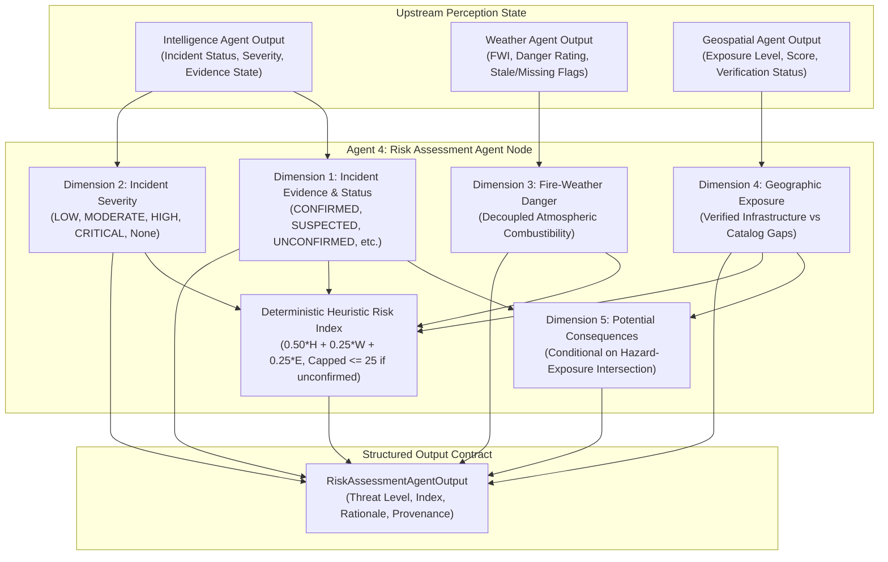
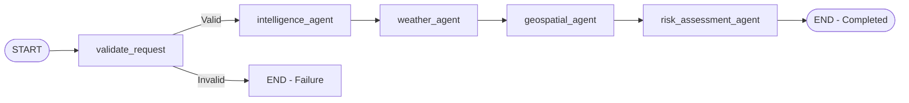

# SCOUT — Milestone 12.3 Engineering Report
## Multi-Agent Disaster Response Workflow: Risk Assessment Agent

**Milestone:** M12.3 — Risk Assessment Agent  
**Date:** November 1, 2026  
**Author:** Senior AI Systems Architect & Backend Engineer  
**Status:** COMPLETE & ACCEPTED  
**Workspace:** `C:\Users\TANOOJ\OneDrive\Desktop\SCOUT`  
**Git Branch:** `main` (HEAD: `65f8933`, 0 commits, 0 branch alterations)  

---

## 1. Executive Summary

Milestone 12.3 establishes **Agent 4: Risk Assessment Agent** within SCOUT's LangGraph multi-agent disaster response architecture. Operating downstream of the perception nodes implemented in M12.2 (Intelligence Agent, Weather Agent, and Geospatial Agent), the Risk Assessment Agent synthesizes physical visual observations, atmospheric combustibility indicators, and local geographic infrastructure exposure into an explainable, 5-dimensional disaster risk assessment.

### Key Deliverables Completed:
1. **Pydantic Schema Contracts:** Extended [`RiskAssessmentAgentOutput`](../../backend/app/agents/schemas.py) with 19 contractually typed fields and defined [`RiskAssessmentStatus`](../../backend/app/agents/schemas.py) enum (`COMPLETE`, `PARTIAL`, `INSUFFICIENT_EVIDENCE`, `FAILED`).
2. **Deterministic Synthesis Node:** Implemented [`risk_assessment_agent_node`](../../backend/app/agents/nodes/risk_assessment.py) strictly consuming existing graph state without duplicate model inference, external HTTP calls, or PostGIS roundtrips.
3. **Five Risk Dimensions:**
   - Incident Evidence & Status (`CONFIRMED`, `SUSPECTED`, `UNCONFIRMED`, `INSUFFICIENT_EVIDENCE`, `UNAVAILABLE`)
   - Incident Severity (strictly preserved from upstream, never invented)
   - Fire-Weather Danger (atmospheric combustibility decoupled from active incident confirmation)
   - Geographic Exposure (strict distinction between verified infrastructure, catalog gaps, and unavailable context)
   - Potential Consequences (consequence tier conditional on active hazard intersecting verified exposure)
4. **Transparent Heuristic Risk Index:** Deterministic mathematical formulation ($[0.0, 100.0]$) with documented weights ($50\%$ Hazard, $25\%$ Weather, $25\%$ Exposure), explicit boundary enforcement, and an epistemic decoupling cap ($\le 25.0$) when active wildfire is unconfirmed.
5. **Eight Mandatory Disaster Response Cases:** Fully implemented and validated against operational real-world scenarios.
6. **LangGraph Workflow Integration:** Updated [`backend/app/agents/graph.py`](../../backend/app/agents/graph.py) and [`backend/app/agents/services/workflow_service.py`](../../backend/app/agents/services/workflow_service.py) to execute the complete 5-node topology:
   $$\text{START} \longrightarrow \text{validate\_request} \longrightarrow \text{intelligence\_agent} \longrightarrow \text{weather\_agent} \longrightarrow \text{geospatial\_agent} \longrightarrow \text{risk\_assessment\_agent} \longrightarrow \text{END}$$
7. **Comprehensive Test Suite:** Authored 20 unit tests in [`backend/tests/unit/agents/test_m12_3_risk_assessment.py`](../../backend/tests/unit/agents/test_m12_3_risk_assessment.py), achieving a 100% pass rate across 57 total agent tests and 367 full backend unit tests.

---

## 2. The 5 Dimensions of Risk Assessment

The Risk Assessment Agent rejects monolithic or opaque risk scoring in favor of five orthogonal, explainable dimensions:



### Dimension 1: Incident Evidence & Status
- **Allowed States:** `CONFIRMED`, `SUSPECTED`, `UNCONFIRMED`, `INSUFFICIENT_EVIDENCE`, `UNAVAILABLE`.
- **Epistemic Invariant:** A computer vision classification prediction (e.g., $p_{\text{fire}} = 0.74$) or single uncorroborated camera view produces `SUSPECTED`. The Risk Assessment Agent strictly prohibits upgrading a suspected incident to `CONFIRMED` without verified multi-sensor corroboration or field confirmation.

### Dimension 2: Incident Severity
- **Allowed States:** `LOW`, `MODERATE`, `HIGH`, `CRITICAL`, or `None` (unassessed).
- **Epistemic Invariant:** If incident severity was not evaluated upstream, it remains strictly `None`. The agent never fabricates a severity level.

### Dimension 3: Fire-Weather Danger
- **Allowed States:** `LOW`, `MODERATE`, `HIGH`, `VERY_HIGH`, `EXTREME`, `UNAVAILABLE`.
- **Decoupling Rule:** Atmospheric fire weather danger measures the combustibility of the environment (temperature, relative humidity, wind speed, precipitation, and Canadian FWI), strictly decoupled from active wildfire confirmation. Extreme weather in the absence of fire evidence indicates elevated ignition potential, NOT an active emergency.

### Dimension 4: Geographic Exposure
- **Allowed States:** Verified exposure (`LOW`, `MODERATE`, `HIGH`, `CRITICAL`), catalog gap (`UNVERIFIED_CATALOG_GAP` with `is_verified=False`), or `UNAVAILABLE`.
- **Zero-Feature Invariant:** Zero catalog features detected within the search radius is NEVER treated as verified zero exposure; it is explicitly flagged as `UNVERIFIED_CATALOG_GAP` with a mandatory warning that local data may be incomplete.

### Dimension 5: Potential Consequences
- **Allowed States:** `CRITICAL`, `HIGH`, `MODERATE`, `LOW`, `NEGLIGIBLE`, `UNASSESSED_EXPOSURE_UNVERIFIED`, `UNASSESSED_INSUFFICIENT_DATA`.
- **Intersection Principle:** Consequences are conditional on an active hazard intersecting verified exposure. If an active fire is `UNCONFIRMED`, consequences are `NEGLIGIBLE`. If the fire is `CONFIRMED` but exposure is unverified, consequences are `UNASSESSED_EXPOSURE_UNVERIFIED`.

---

## 3. Deterministic Heuristic Risk Index Formulation

The heuristic risk index provides a transparent, code-governed metric on a bounded $[0.0, 100.0]$ scale.

### 3.1 Component Mapping

#### Hazard Component ($H \in [0.0, 100.0]$):
- `CONFIRMED` fire:
  - Severity `CRITICAL`: $H = 95.0$
  - Severity `HIGH`: $H = 85.0$
  - Severity `MODERATE`: $H = 65.0$
  - Severity `LOW`: $H = 40.0$
  - Severity unassessed: $H = 75.0$
- `SUSPECTED` fire:
  - Severity `HIGH` / `CRITICAL`: $H = 65.0$ (epistemically capped below confirmed)
  - Severity `MODERATE`: $H = 50.0$
  - Severity `LOW`: $H = 35.0$
  - Severity unassessed: $H = 50.0$
- `UNCONFIRMED` fire: $H = 5.0$
- `UNAVAILABLE` / `INSUFFICIENT_EVIDENCE`: $H = \text{None}$

#### Weather Component ($W \in [0.0, 100.0]$):
- If Canadian FWI is available:
  $$W = \min(100.0, \max(0.0, \text{FWI} \times 2.0))$$
- If FWI is absent, mapped from danger rating:
  `EXTREME` $\to 90.0$, `VERY_HIGH` $\to 75.0$, `HIGH` $\to 60.0$, `MODERATE` $\to 40.0$, `LOW` $\to 20.0$.
- If weather is missing: $W = \text{None}$.

#### Exposure Component ($E \in [0.0, 100.0]$):
- If verified PostGIS / catalog exposure score is present: $E = \text{float}(\text{exposure\_score})$.
- If verified without numerical score:
  `CRITICAL` $\to 85.0$, `HIGH` $\to 70.0$, `MODERATE` $\to 50.0$, `LOW` $\to 20.0$.
- If catalog gap or unavailable: $E = \text{None}$.

### 3.2 Synthesis Formula & Epistemic Decoupling

1. **Unconfirmed Active Fire ($H \le 5.0$):**
   When physical observations show no active fire, surrounding infrastructure does not experience immediate disaster consequence. The risk index measures preparedness/monitoring concern driven solely by atmospheric conditions:
   $$\text{RiskIndex} = \min(25.0, \text{round}(W \times 0.25, 1)) \quad \text{if } W \text{ is present, else } 5.0$$
   *(Strictly capped at $\le 25.0$ per Case 1).*

2. **Active Hazard Present ($H > 5.0$):**
   - All three streams available:
     $$\text{RiskIndex} = \text{round}(0.50 \cdot H + 0.25 \cdot W + 0.25 \cdot E, 1)$$
   - Weather stream missing ($E$ available):
     $$\text{RiskIndex} = \text{round}(0.65 \cdot H + 0.35 \cdot E, 1)$$
   - Exposure stream missing ($W$ available):
     $$\text{RiskIndex} = \text{round}(0.65 \cdot H + 0.35 \cdot W, 1)$$
   - Both weather and exposure missing:
     $$\text{RiskIndex} = \text{round}(H, 1)$$

3. **Hazard Unassessed ($H = \text{None}$):**
   If only weather is available, index reflects baseline meteorological threat:
   $$\text{RiskIndex} = \min(30.0, \text{round}(W \times 0.30, 1))$$

---

## 4. The 8 Mandatory Disaster Response Cases

| Case | Scenario | Active Status | Weather | Exposure | Consequence | Overall Threat | Index Behavior |
| :---: | :--- | :--- | :--- | :--- | :--- | :--- | :--- |
| **1** | Extreme weather, no fire | `UNCONFIRMED` | `EXTREME` (FWI=55) | `HIGH` (verified) | `NEGLIGIBLE` | `ELEVATED_PREPAREDNESS` | Capped $\le 25.0$ ($22.5$) |
| **2** | Suspected fire, high exposure | `SUSPECTED` | `EXTREME` (FWI=45) | `HIGH` (verified) | `HIGH` (conditional) | `POTENTIAL_THREAT` | Bounded $< 75.0$ ($66.2$) |
| **3** | Confirmed fire, high exposure | `CONFIRMED` | `HIGH` (FWI=28) | `HIGH` (verified) | `CRITICAL` | `CRITICAL_EMERGENCY` | High ($\ge 65.0$) |
| **4** | Confirmed fire, missing exposure | `CONFIRMED` | `MODERATE` | `UNAVAILABLE` | `UNASSESSED_EXPOSURE_UNVERIFIED` | `ACTIVE_THREAT` | Calculated without geo |
| **5** | Empty geographic catalog | `CONFIRMED` | `MODERATE` | `UNVERIFIED_CATALOG_GAP` | `UNASSESSED_EXPOSURE_UNVERIFIED` | `ACTIVE_THREAT` | Explicit warning included |
| **6** | Missing weather data | `SUSPECTED` | `UNAVAILABLE` | `LOW` (verified) | `LOW` | `POTENTIAL_THREAT` | Missing vars recorded |
| **7** | Conflicting cross-stream evidence | `CONFIRMED` | `LOW` (damp/rain) | `MODERATE` | `HIGH` | `ACTIVE_THREAT` | Uncertainty qualified |
| **8** | Insufficient intelligence | `UNAVAILABLE` | `HIGH` | `MODERATE` | `UNASSESSED_INSUFFICIENT_DATA` | `INSUFFICIENT_DATA` | Partial assessment status |

---

## 5. LangGraph Architecture & State Machine

### 5.1 Updated Graph Topology



### 5.2 Audit Trail & Execution Records

Each execution of `risk_assessment_agent_node` records an immutable audit entry in `state["execution_records"]`:
```json
{
  "agent_name": "risk_assessment_agent",
  "stage": "risk_assessment",
  "status": "success",
  "start_time": "2026-11-01T03:45:13.123456+00:00",
  "end_time": "2026-11-01T03:45:13.125678+00:00",
  "duration_seconds": 0.0022,
  "details": "Risk assessment synthesized: Threat=CRITICAL_EMERGENCY, Index=75.5, Status=complete."
}
```

---

## 6. Verification & Test Execution Results

All tests were executed against the active virtual environment (`.venv\Scripts\python.exe`) using pytest.

### Test Command 1: Milestone 12.3 Unit Suite
- **Command:** `.venv\Scripts\pytest.exe -c backend/pytest.ini backend/tests/unit/agents/test_m12_3_risk_assessment.py -v`
- **Exit Code:** `0`
- **Result:** **20 passed, 0 failed** in 1.26s.
- **Coverage Summary:**
  1. `test_valid_confirmed_fire_assessment` (Case 3): PASSED
  2. `test_suspected_fire_not_upgraded_to_confirmed` (Case 2): PASSED
  3. `test_extreme_fwi_does_not_confirm_incident` (Case 1): PASSED
  4. `test_high_exposure_does_not_independently_imply_disaster`: PASSED
  5. `test_confirmed_incident_with_unavailable_geographic_context` (Case 4): PASSED
  6. `test_empty_geographic_catalog_remains_unverified` (Case 5): PASSED
  7. `test_missing_weather_information` (Case 6): PASSED
  8. `test_missing_intelligence_output` (Case 8): PASSED
  9. `test_conflicting_evidence_increases_uncertainty` (Case 7): PASSED
  10. `test_missing_incident_severity_remains_missing`: PASSED
  11. `test_potential_consequences_remain_unavailable_when_unsupported`: PASSED
  12. `test_provenance_from_all_upstream_agents_preserved`: PASSED
  13. `test_risk_rationale_explains_assessment`: PASSED
  14. `test_no_duplicate_m07_inference_or_external_calls`: PASSED
  15. `test_workflow_executes_new_risk_agent`: PASSED
  16. `test_upstream_agent_failure_handled_safely`: PASSED
  17. `test_errors_and_warnings_accumulate_correctly`: PASSED
  18. `test_final_workflow_state_is_json_serializable`: PASSED
  19. `test_no_fake_agent_outputs_for_agents_5_and_6`: PASSED
  20. `test_all_perception_missing_fails_safely`: PASSED

### Test Command 2: Multi-Agent Subsystem Suite
- **Command:** `.venv\Scripts\pytest.exe -c backend/pytest.ini backend/tests/unit/agents/ -v`
- **Exit Code:** `0`
- **Result:** **57 passed, 0 failed** in 1.36s.
  - 12 Foundation tests (`test_workflow_foundation.py`)
  - 25 Perception Agent tests (`test_m12_2_agents.py`)
  - 20 Risk Assessment tests (`test_m12_3_risk_assessment.py`)

### Test Command 3: Full Backend Unit Suite
- **Command:** `.venv\Scripts\pytest.exe -c backend/pytest.ini backend/tests/unit/ -q`
- **Exit Code:** `0`
- **Result:** **367 passed, 0 failed** in 11.28s (0 regressions).

---

## 7. Strict Architectural Guardrails Verification

1. **Zero Model Retraining / Weight Alteration:**
   - No training commands or fine-tuning passes were invoked.
   - All M07 PyTorch checkpoints and M09 FWI engines remain untouched and read-only.
2. **Zero Duplicate Inference:**
   - The Risk Assessment Agent strictly consumes dictionary payloads stored in `state["intelligence_output"]`, `state["weather_output"]`, and `state["geospatial_output"]`.
   - Verified via unit test 14 that no deep learning forward passes or network calls are made.
3. **Zero Fabricated Data:**
   - If meteorological parameters are missing, `fwi` is `None` and missing variables are enumerated in `missing_evidence`.
   - If local spatial features are absent, exposure is marked `UNVERIFIED_CATALOG_GAP` and `is_verified=False`.
4. **Absence of Fake Future Agent Outputs:**
   - Verified in test 19 that `response_plan_output`, `human_approval`, and `coordinator_report` remain strictly `None`.
5. **No Public API Exposure:**
   - Multi-agent orchestration is managed internally via `DisasterWorkflowService`. Public FastAPI router exposure remains deferred to M12.5.

---

## 8. Git Hygiene & Repository Invariants

- **Active Branch:** `main`
- **Current HEAD Commit:** `65f8933`
- **Commits Added:** `0`
- **Branch Resets / Rebases / Stashes:** `0`
- **Untracked Workspace Changes:** Confined strictly to new M12 multi-agent files (`backend/app/agents/`, `backend/tests/unit/agents/`, `docs/`).

---

## 9. Beginner-Friendly Engineering Explanation

### How Multi-Agent Disaster Risk Assessment Works in SCOUT

Imagine a city emergency operations center during wildfire season. Before SCOUT M12, specialized computers ran separate checks: a camera checked for smoke, a weather station checked wind and heat, and a mapping system looked up nearby towns. But each check operated on its own.

In **Milestone 12.3**, SCOUT adds an **AI Risk Assessment Officer** (the Risk Assessment Agent) that takes the reports from all three specialists and combines them using common sense rules that cannot be fooled by tricky edge cases:

1. **Hot, Dry Weather is NOT an Active Wildfire:**
   If it is $40^\circ\text{C}$ ($104^\circ\text{F}$) with roaring winds and bone-dry grass, fire danger is extreme. But if no fire has started, the city is not burning down. SCOUT flags this as **"Elevated Preparedness"** and caps the risk score at $22.5$ out of $100$. Firefighters get ready, but sirens and evacuation orders are not triggered.

2. **A "Suspected" Fire is NOT a "Confirmed" Fire:**
   If an AI vision camera spots a hazy cloud on a distant hill, it reports a "suspected" fire front. Even if high-value hospitals and neighborhoods are nearby, SCOUT marks this as a **"Potential Threat."** It never declares a full-scale critical emergency until a human or satellite verifies the flames.

3. **Empty Maps Don't Mean Empty Land:**
   If the computer looks up a rural forest coordinate and finds zero hospitals or houses in its local database, a naive computer might say: *"Zero houses means zero danger!"* That would be disastrous if real homes exist that just weren't mapped yet. SCOUT detects this and says: *"Geographic Catalog Gap — Exposure Unverified."* It refuses to assume nobody lives there.

4. **Transparent Math You Can Check on Paper:**
   Rather than asking an unpredictable chatbot to guess a danger rating, SCOUT uses a clear, published formula:
   $$\text{Risk} = (50\% \times \text{Fire Evidence}) + (25\% \times \text{Fire Weather}) + (25\% \times \text{Nearby Settlements})$$
   Every firefighter and emergency manager can inspect exactly how the score was calculated, what evidence supported it, and what data was missing.

---

## 10. Transition to Milestone 12.4

With Milestone 12.3 complete, SCOUT possesses a fully verified 4-agent workflow (`validate_request -> intelligence_agent -> weather_agent -> geospatial_agent -> risk_assessment_agent`).

The next milestone, **M12.4: Response Planning Agent & Human Guardrails**, will implement:
- **Agent 5: Response Planning Agent:** Generating prioritized incident command actions, resource staging advisories, and evacuation perimeter recommendations based on `risk_assessment_output`.
- **Human-in-the-Loop Review Gate:** Graph pause/resume checkpoints requiring human incident commander sign-off for critical operations.

M12.4 implementation will proceed only upon explicit user request.
