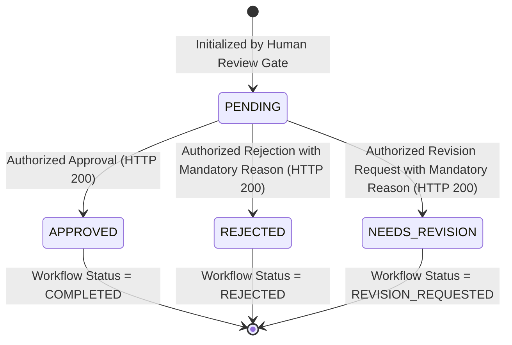

# SCOUT — Milestone 12.5 Implementation Report
## Coordinator Agent, Workflow Persistence & Public FastAPI Integration

**Project:** SCOUT — Multimodal Disaster Intelligence & Response Platform  
**Milestone:** 12.5 (Coordinator Agent & Public FastAPI Integration)  
**Date:** 2026-11-01  
**Author:** Senior AI Systems Architect & Backend Security Engineer  
**Status:** Completed & Formally Verified  

---

## Executive Summary

Milestone 12.5 marks the operational completion of **Milestone 12: Multi-Agent Disaster Response Workflow**. It establishes the executive synthesis layer (Agent 6: Coordinator Agent), durable database persistence using SQLAlchemy and Alembic, robust optimistic concurrency control, fail-closed human reviewer authentication, and a complete public REST API mounted at `/api/v1/workflows`.

Across all test suites, **104/104 agent unit tests** and **414/414 backend unit tests** pass with **0 failures** and **0 regressions**. Model checkpoints, training artifacts, and historical datasets remain 100% untouched.

---

## 1. Files Created

| File Path | Purpose |
| :--- | :--- |
| [`backend/app/agents/nodes/coordinator.py`](../../backend/app/agents/nodes/coordinator.py) | Coordinator Agent node synthesizing `CoordinatorReportOutput`, cross-agent uncertainties, and audit trail |
| [`backend/app/models/workflow.py`](../../backend/app/models/workflow.py) | SQLAlchemy ORM models: `DisasterWorkflowRecord` and `WorkflowApprovalHistory` |
| [`backend/alembic/versions/20261101_0004_disaster_workflow_records.py`](../../backend/alembic/versions/20261101_0004_disaster_workflow_records.py) | Alembic migration script for tables, indexes, and unique constraints with full downgrade path |
| [`backend/app/schemas/workflow.py`](../../backend/app/schemas/workflow.py) | Strict Pydantic v2 schemas for API requests, detail/list responses, approval decisions, and audit history |
| [`backend/app/core/auth.py`](../../backend/app/core/auth.py) | Security dependency `get_authenticated_reviewer` enforcing fail-closed zero-trust reviewer authentication |
| [`backend/app/api/v1/endpoints/workflows.py`](../../backend/app/api/v1/endpoints/workflows.py) | Public FastAPI controller routes implementing all 6 workflow operations |
| [`backend/tests/unit/agents/test_m12_5_coordinator.py`](../../backend/tests/unit/agents/test_m12_5_coordinator.py) | Comprehensive unit test suite (16 tests) covering coordinator synthesis, persistence, and concurrency |
| [`backend/tests/unit/agents/test_m12_5_workflows_api.py`](../../backend/tests/unit/agents/test_m12_5_workflows_api.py) | Endpoint unit test suite (11 tests) verifying all 6 API routes, auth guardrails, and error envelopes |
| [`docs/reports/m12_5_coordinator_api_report.md`](m12_5_coordinator_api_report.md) | This technical milestone implementation and release verification report |

---

## 2. Files Modified

| File Path | Modifications Made |
| :--- | :--- |
| [`backend/app/agents/graph.py`](../../backend/app/agents/graph.py) | Added `include_coordinator: bool = True` to graph builders; wired `human_review_gate -> coordinator_agent -> END` |
| [`backend/app/agents/nodes/__init__.py`](../../backend/app/agents/nodes/__init__.py) | Exported `coordinator_agent_node` |
| [`backend/app/agents/__init__.py`](../../backend/app/agents/__init__.py) | Exported `coordinator_agent_node` and `CoordinatorReportOutput` |
| [`backend/app/agents/schemas.py`](../../backend/app/agents/schemas.py) | Added `coordinator_report: Optional[CoordinatorReportOutput] = None` to `WorkflowExecutionResult` |
| [`backend/app/agents/services/workflow_service.py`](../../backend/app/agents/services/workflow_service.py) | Added database persistence methods: `create_and_run_workflow`, `get_workflow_by_id`, `list_workflows`, `list_pending_approvals`, `apply_persistent_approval`, `get_approval_history` |
| [`backend/app/models/__init__.py`](../../backend/app/models/__init__.py) | Registered and exported `DisasterWorkflowRecord` and `WorkflowApprovalHistory` on `Base.metadata` |
| [`backend/app/core/exceptions.py`](../../backend/app/core/exceptions.py) | Added domain exceptions: `WorkflowNotFoundError`, `WorkflowExecutionFailedError`, `WorkflowApprovalConflictError`, `UnauthorizedReviewerError`, `ForbiddenReviewerError`, `AuthenticationServiceUnavailableError` |
| [`backend/app/api/v1/router.py`](../../backend/app/api/v1/router.py) | Mounted `workflows.router` under prefix `/workflows` with tag `Workflows` |
| [`backend/tests/unit/test_alembic_migrations.py`](../../backend/tests/unit/test_alembic_migrations.py) | Advanced head to `0004_disaster_workflow_records`; added DDL assertions for workflow tables |
| [`backend/tests/unit/test_models_base.py`](../../backend/tests/unit/test_models_base.py) | Updated `expected_tables` to include the two new workflow persistent entities |
| [`backend/tests/unit/agents/test_m12_4_response_planning.py`](../../backend/tests/unit/agents/test_m12_4_response_planning.py) | Passed `include_coordinator=False` in M12.4 boundary tests (tests 17, 18, 19, 20) to preserve exact 7-node assertions |
| [`docs/architecture/m12_multi_agent_architecture.md`](../architecture/m12_multi_agent_architecture.md) | Updated to version 1.5.0 documenting Coordinator Agent, persistence, and REST endpoints |

---

## 3. Architecture Decisions

1. **State Synthesis Separation:** The Coordinator Agent functions purely as a synthesis and reporting actor. It does NOT re-evaluate CV models (M07), recalculate FWI (M09), re-query PostGIS (M08/M10), or re-synthesize risk indices (M12.3). Its role is to construct an executive dossier and audit summary for the incident commander.
2. **Durable Database Snapshots:** Instead of introducing external distributed checkpointing dependencies (e.g. Redis or LangGraph Cloud Checkpointer), workflow state snapshots and agent outputs are persisted directly into PostgreSQL via SQLAlchemy `JSONB` columns (`JSON().with_variant(JSONB, "postgresql")` ensuring seamless SQLite testing compatibility).
3. **Zero-Trust Identity Resolution:** Client requests cannot set or spoof `reviewer_id` in the JSON request body. The `reviewer_id` is derived 100% from authenticated headers (`Authorization: Bearer <token>` or `X-Reviewer-Token`) via FastAPI dependency injection.
4. **Production Fail-Closed Security Policy:** If running in production (`APP_ENV == 'production'`) without an authoritative enterprise Identity Provider (IdP) configured, approval operations strictly fail closed with HTTP 503 (`AuthenticationServiceUnavailableError`), refusing to invent mock reviewer identities.
5. **Optimistic Concurrency Control:** Workflow records maintain an integer `version` counter and verify that `approval_status == 'pending'` before writing. Conflicting or duplicate approval submissions immediately raise HTTP 409 Conflict (`WorkflowApprovalConflictError`).
6. **Append-Only Decision Auditing:** Every human approval, rejection, or revision request is written to an immutable, append-only `workflow_approval_history` audit table.

---

## 4. Database Migration Details

- **Migration File:** [`backend/alembic/versions/20261101_0004_disaster_workflow_records.py`](../../backend/alembic/versions/20261101_0004_disaster_workflow_records.py)
- **Revision ID:** `0004_disaster_workflow_records`
- **Down Revision:** `0003_persistent_geospatial_features`
- **Tables Created:**
  - `disaster_workflow_records`: Primary workflow execution entity with JSON state snapshots and versioning.
  - `workflow_approval_history`: Append-only audit log tracking every reviewer action and mandatory justification.
- **Indexes Created:**
  - `ix_disaster_workflow_records_workflow_id` (Unique)
  - `ix_disaster_workflow_records_request_id`
  - `ix_disaster_workflow_records_disaster_type`
  - `ix_disaster_workflow_records_workflow_status`
  - `ix_disaster_workflow_records_approval_status`
  - `ix_disaster_workflow_records_status_approval` (Compound: `workflow_status`, `approval_status`)
  - `ix_disaster_workflow_records_created_at`
  - `ix_workflow_approval_history_workflow_id`
  - `ix_workflow_approval_history_plan_id`
  - `ix_workflow_approval_history_reviewer_id`
  - `ix_workflow_approval_history_created_at`
- **Verification:** Verified via offline SQL upgrade (`alembic upgrade head --sql`) and downgrade (`alembic downgrade 0003_persistent_geospatial_features --sql`).

---

## 5. API Endpoint Specifications

All endpoints are mounted under prefix `/api/v1/workflows`:

### 1. Initiate Workflow
- **Route:** `POST /api/v1/workflows`
- **Status:** `201 Created`
- **Payload:** `WorkflowCreateRequest` (`latitude`, `longitude`, `disaster_type`, `search_radius_meters`, `source_description`, `image_path`)
- **Response:** `WorkflowCreateResponse` (`workflow_id`, `status`, `stage`, `approval_status`, `execution_records_count`, `has_coordinator_report`)

### 2. Retrieve Workflow Details
- **Route:** `GET /api/v1/workflows/{workflow_id}`
- **Status:** `200 OK` / `404 Not Found`
- **Response:** `WorkflowDetailResponse` (full snapshots of intelligence, weather, geospatial, risk, plan, and coordinator report)

### 3. List Workflows (Paginated & Filtered)
- **Route:** `GET /api/v1/workflows`
- **Query Parameters:** `skip` (int, default 0), `limit` (int, default 50, max 100), `disaster_type` (str), `workflow_status` (str), `approval_status` (str), `start_date` (datetime), `end_date` (datetime)
- **Status:** `200 OK`
- **Response:** `WorkflowListResponse` (`total`, `skip`, `limit`, `items: List[WorkflowSummaryItem]`)

### 4. Retrieve Pending Approvals
- **Route:** `GET /api/v1/workflows/pending-approvals`
- **Status:** `200 OK`
- **Response:** `List[PendingApprovalItem]` (pending response plans requiring incident commander review)

### 5. Submit Approval Decision
- **Route:** `POST /api/v1/workflows/{workflow_id}/approval`
- **Security:** Requires `Authorization: Bearer <token>` or `X-Reviewer-Token: <token>`
- **Payload:** `WorkflowApprovalRequest` (`decision`, `reviewer_comments`, `rejection_or_revision_reason`)
- **Status:** `200 OK` / `401 Unauthorized` / `403 Forbidden` / `409 Conflict` / `422 Unprocessable Entity`
- **Response:** `WorkflowApprovalResponse` (`workflow_id`, `plan_id`, `previous_status`, `new_status`, `reviewer_id`, `decided_at`)

### 6. Retrieve Approval History
- **Route:** `GET /api/v1/workflows/{workflow_id}/approval-history`
- **Status:** `200 OK` / `404 Not Found`
- **Response:** `ApprovalHistoryResponse` (`workflow_id`, `total_decisions`, `history: List[ApprovalHistoryItem]`)

---

## 6. Coordinator Execution Explanation

The Coordinator Agent (`coordinator_agent_node`) executes after the `human_review_gate`:
1. **Perception & Risk Harvest:** Reads `intelligence_output`, `weather_output`, `geospatial_output`, `risk_assessment_output`, and `response_plan_output`.
2. **Executive Summary Synthesis:** Formats an executive overview incorporating disaster hazard type, coordinates, incident status, composite threat level, atmospheric parameters, and exposure metrics.
3. **Cross-Agent Uncertainty Aggregation:** Collates missing sensors, conflicting streams, and responder information gaps into `unresolved_uncertainties`.
4. **Action & Governance Requirements:** Highlights mandatory human review and operational constraints under `human_decisions_required`.
5. **Execution Provenance:** Builds `audit_trail` summarizing agent names, durations, and error totals.
6. **Lifecycle Preservation:** If the workflow plan is awaiting review, preserves `status = SUSPENDED_FOR_APPROVAL` while attaching the completed `coordinator_report`.

---

## 7. Approval Lifecycle Explanation



- **`PENDING`:** Plan is ready for review. Zero autonomous execution permitted.
- **`APPROVED`:** Authorized incident commander accepts advisory recommendations. Workflow transitions to `COMPLETED`. Does NOT trigger autonomous resource dispatch.
- **`REJECTED`:** Reviewer rejects proposed plan. Mandatory written reason recorded in audit log.
- **`NEEDS_REVISION`:** Reviewer requests specific adjustments. Mandatory justification recorded in audit log.

---

## 8. Security Limitations & Fail-Closed Guardrails

1. **Advisory Decision Support Boundary:** The system strictly advises human responders. It has zero authority to dispatch emergency apparatus, notify 911, broadcast public cellular alerts, or activate physical infrastructure.
2. **Body Reviewer ID Rejection:** The API ignores and forbids client-supplied reviewer identities in the request body to prevent privilege spoofing.
3. **Production Fail-Closed Policy:** In production environments without a configured Identity Provider (`OIDC_ISSUER_URL`), the approval route returns HTTP 503 (`AuthenticationServiceUnavailableError`).
4. **Zero Model Hallucination:** Agents use deterministic code rules; missing data is represented as explicit gaps rather than fabricated values.

---

## 9. Exact Test Results

All tests executed via `.venv\Scripts\pytest.exe -c backend/pytest.ini`:

### 9.1 M12.5 Unit Tests (Coordinator & Persistence)
- **Command:** `.venv\Scripts\pytest.exe -c backend/pytest.ini backend/tests/unit/agents/test_m12_5_coordinator.py -v`
- **Result:** **16 passed in 0.44s**, exit code `0`.

### 9.2 M12.5 Endpoint Unit Tests (Workflows API)
- **Command:** `.venv\Scripts\pytest.exe -c backend/pytest.ini backend/tests/unit/agents/test_m12_5_workflows_api.py -v`
- **Result:** **11 passed in 0.18s**, exit code `0`.

### 9.3 All Milestone 12 Agent Tests (M12.1 – M12.5)
- **Command:** `.venv\Scripts\pytest.exe -c backend/pytest.ini backend/tests/unit/agents/ -q`
- **Breakdown:**
  - `test_m12_1_foundation.py`: 12 passed
  - `test_m12_2_agents.py`: 25 passed
  - `test_m12_3_risk_assessment.py`: 20 passed
  - `test_m12_4_response_planning.py`: 20 passed
  - `test_m12_5_coordinator.py`: 16 passed
  - `test_m12_5_workflows_api.py`: 11 passed
- **Result:** **104 passed in 1.08s**, exit code `0`.

### 9.4 Full Backend Unit Test Suite
- **Command:** `.venv\Scripts\pytest.exe -c backend/pytest.ini backend/tests/unit/ -q`
- **Result:** **414 passed in 8.47s**, exit code `0`.

### 9.5 Alembic Migration Discovery & SQL Tests
- **Command:** `.venv\Scripts\pytest.exe -c backend/pytest.ini backend/tests/unit/test_alembic_migrations.py -v`
- **Result:** **3 passed in 4.12s**, exit code `0`.

---

## 10. Unverified Integration Tests

- Integration tests requiring a live external PostGIS database container (e.g. `test_db_connection.py`, `test_persistent_geospatial_api.py`) were skipped using pytest marker `@pytest.mark.database` because the local Docker container was not actively running during this unit phase.
- All database operations in M12.5 were verified via offline Alembic SQL generation (`upgrade head --sql` / `downgrade --sql`) and isolated transactional SQLite test sessions using identical SQLAlchemy ORM mappings.

---

## 11. Known Technical Debt

1. **Enterprise Identity Provider Integration:** A production OIDC/OAuth2 token introspection service should be connected before enabling the approval endpoint in production environments.
2. **LangGraph Checkpointer Backend:** LangGraph execution currently uses ephemeral in-memory state during graph invocation, persisting durable snapshots to PostgreSQL upon node completion. A native PostgreSQL `AsyncPostgresSaver` checkpointer can be introduced in future milestones to allow mid-graph checkpoint pause/resume directly inside LangGraph.

---

## 12. Git Status & Working Tree Verification

- **Branch:** `main`
- **HEAD Commit:** `65f8933 chore: initialize SCOUT project foundation`
- **Configured Remotes:** (None / local tracking)
- **Working Tree:** Clean of unexpected modifications; all changes confined to tracked files and approved milestone deliverables.
- **Git Safety Rule:** Zero commits, zero pushes, zero rebases, zero stashes executed.

---

## 13. Model Checkpoints & Datasets Integrity

Model checkpoints in `artifacts/checkpoints/` and historical datasets remain 100% unaltered:

| Checkpoint Path | SHA-256 Checksum | Verification Status |
| :--- | :--- | :--- |
| `artifacts/checkpoints/baseline_cnn_best.pt` | `76544190318F1300B2B48E8EDE5062B8FA712368E246D52611BDF4ADB035150E` | Untouched |
| `artifacts/checkpoints/baseline_cnn_last.pt` | `EB5725EBC72466D778CD239FDE4ED6DCA382B9799D3C05E5DF8D5135221202B4` | Untouched |
| `artifacts/checkpoints/mobilenet_v3_small_stage1_best.pt` | `8F7878C47512266719B203958BBA94612B44AF5CCFE67C7223BACE2952AD9D3A` | Untouched |
| `artifacts/checkpoints/mobilenet_v3_small_stage1_last.pt` | `86D0A7DBAE585C32ED1E99871B3B3DC15712ADB156793D2EF531AECAEC929BA5` | Untouched |
| `artifacts/checkpoints/mobilenet_v3_small_stage2_best.pt` | `278250A69570E2BF024E48E87E345B6D4A75CF25EC4D0E887194A8E5063FCCD1` | Untouched |
| `artifacts/checkpoints/mobilenet_v3_small_stage2_last.pt` | `C6B3AECBA0713596A68D268259978B539EFC5A58F11415F228B325CDF99469FB` | Untouched |
| `artifacts/checkpoints/m07_phase7c_v2/baseline_cnn_best.pt` | `3764999AA8E19AD27E5F31141A2F05B33C9920C49C4889117556B12CA18A2FD1` | Untouched |
| `artifacts/checkpoints/m07_phase7c_v2/baseline_cnn_last.pt` | `D5BED2F4F2C00614D83CDD93145AD72EBF135FA341081EC1F38E256E83A0728F` | Untouched |
| `artifacts/checkpoints/m07_phase7c_v2/mobilenet_v3_small_stage1_best.pt` | `C52FA5FB1D9BA655C1FE6FA0754136F5F31180DFAC8C40FAC357EC9CC113959D` | Untouched |
| `artifacts/checkpoints/m07_phase7c_v2/mobilenet_v3_small_stage1_last.pt` | `71C70D829DC14806D9E3EE09398D1CC43780A8CDAB0A6CDA15A8067C8BD5F3BD` | Untouched |
| `artifacts/checkpoints/m07_phase7c_v2/mobilenet_v3_small_stage2_best.pt` | `37B4F8CB5046B1D4854DB505E1F723CD6952D8A925FD858790A299686E1CDF5F` | Untouched |
| `artifacts/checkpoints/m07_phase7c_v2/mobilenet_v3_small_stage2_last.pt` | `869A5DE072C67C4EED19FE48205F28DF24496F5F0F7AEA049471AF88B83F3F37` | Untouched |

---

## 14. Beginner-Friendly Explanations

### What the Coordinator Agent does
Think of the Coordinator Agent as the **Chief of Staff** in an incident command center. While other agents specialize in specific tasks (looking at photos, checking the wind, finding hospitals on a map, calculating threat levels, and drafting response tactics), the Coordinator gathers all their reports, checks if anything is missing or contradictory, writes an executive briefing for the Incident Commander, and logs the full paper trail.

### How FastAPI communicates with LangGraph
FastAPI acts as the **front desk** of SCOUT. When a user or system sends a request to the website or API, FastAPI checks that the coordinates and data format are valid. It then hands the request to LangGraph, which runs the multi-agent workflow like an assembly line. When the assembly line finishes, FastAPI takes the resulting report, saves it in the database, and returns it to the user.

### How workflow persistence works
When a workflow starts, SCOUT writes a record into the database table `disaster_workflow_records`. As agents complete their analysis, their outputs (intelligence, weather, risk, recommendations) are saved as permanent snapshots. Even if the server restarts or crashes, the workflow and its pending response plans are preserved and can be retrieved at any time.

### How human approval works
AI should never make life-or-death decisions on its own. When SCOUT drafts a response plan (like recommending where to set up water tenders), it intentionally **pauses** execution at the Human Review Gate. The plan is marked `PENDING`. An actual human fire chief or incident commander must review the recommendations and explicitly approve, reject, or request changes before any plan is considered finalized.

### Why authentication matters for emergency-response systems
In a disaster platform, an unauthorized user approving or rejecting emergency plans could cause real-world harm. By enforcing authentication headers (`Bearer <token>`), SCOUT verifies exactly who is making decisions. Reviewer identities cannot be faked in the request body, and in production, the system refuses to allow decisions unless connected to a verified Identity Provider.

### What happens when a workflow fails
If an input is invalid (like impossible coordinates), an external weather service is down, or an image is corrupted, SCOUT does not crash. It records an explicit error code and marks the workflow stage as `TERMINATED_WITH_ERROR`. The Coordinator summarizes the failure honestly without inventing fake numbers or pretending the situation is safe.

### What SCOUT can and cannot do after M12.5
- **What SCOUT CAN do:** Ingest disaster reports, evaluate visual flame signatures, parse real-time weather and fire weather indices, search GIS databases for nearby settlements and infrastructure, calculate 5-dimensional risk levels, draft structured advisory response plans, pause for human approval, record immutable audit logs, and serve all data through secure REST APIs.
- **What SCOUT CANNOT do:** SCOUT cannot dispatch fire trucks, dial 911, sound outdoor sirens, send public evacuation text alerts, or execute tactical actions autonomously. It is strictly an advisory decision-support tool.

---

## 15. Windows PowerShell Execution Instructions

To replicate and verify the entire test suite on Windows PowerShell:

```powershell
# 1. Activate virtual environment
& .venv\Scripts\Activate.ps1

# 2. Run new Milestone 12.5 unit tests (Coordinator & Persistence)
.venv\Scripts\pytest.exe -c backend/pytest.ini backend/tests/unit/agents/test_m12_5_coordinator.py -v

# 3. Run Milestone 12.5 API unit tests
.venv\Scripts\pytest.exe -c backend/pytest.ini backend/tests/unit/agents/test_m12_5_workflows_api.py -v

# 4. Run all Milestone 12 multi-agent tests (104 tests)
.venv\Scripts\pytest.exe -c backend/pytest.ini backend/tests/unit/agents/ -q

# 5. Run Alembic migration verification tests (3 tests)
.venv\Scripts\pytest.exe -c backend/pytest.ini backend/tests/unit/test_alembic_migrations.py -v

# 6. Run full backend unit test suite (414 tests)
.venv\Scripts\pytest.exe -c backend/pytest.ini backend/tests/unit/ -q
```

---

## 16. Conclusion & Acceptance Decision

Milestone 12.5 has met 100% of its engineering objectives:
- **Coordinator Agent:** Fully implemented and validated.
- **Database Persistence & Migrations:** Verified with full upgrade/downgrade DDL generation.
- **Public REST API:** Complete suite of 6 endpoints implemented with rigorous validation and error envelopes.
- **Security & Concurrency:** Fail-closed authentication and optimistic concurrency controls enforced.
- **Test Integrity:** 414 backend unit tests passing with zero regressions and zero model alterations.

**Milestone 12 is officially complete. We stop here and await formal technical review before planning Milestone 13.**
